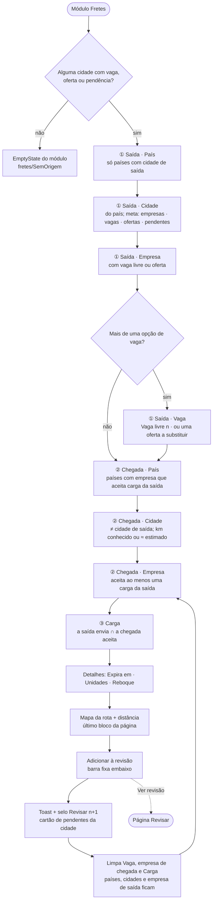
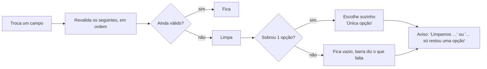
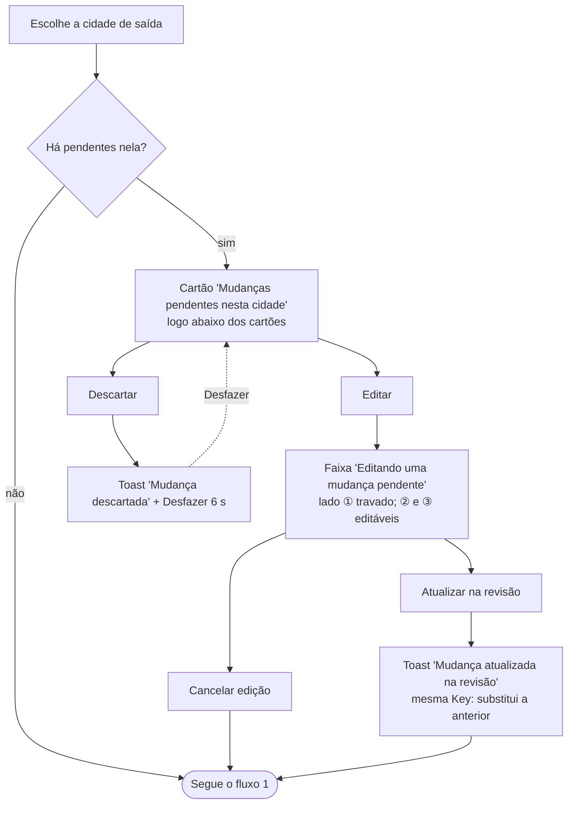

# Fretes País → Cidade — fluxos

Encaixe no ciclo do shell: **explorar** (escolher saída e chegada) → **editar** (carga e prazo, na mesma página) → **revisar** (página Revisar, selo "Revisar (n)") → **aplicar** (confirmação e resultado, em `design/review-apply/`). Nada é gravado aqui.

## 1. Caminho principal

- **Opção única = escolhida sozinha** em qualquer campo, com a etiqueta "Única opção". A Vaga, com uma só opção, nem aparece.
- **Vaga**: com 2+ opções o padrão é "Vaga livre (n)" se houver vaga livre; se só houver ofertas o campo fica vazio e a barra diz "Falta escolher: vaga".
- **Mapa e distância** são o **último bloco da página** (depois de Carga e detalhes, acima da barra fixa; a página rola). A rota e a distância (conhecida ou "≈ estimada") aparecem assim que as duas cidades existem, mesmo antes da carga; antes, o mapa diz "Escolha as duas cidades". O mapa é só consulta: nenhuma escolha depende dele.
- **Detalhes** (Expira em, Unidades, Reboque) só existem com a carga escolhida. O prazo padrão é 72 h.
- **A chegada só abre depois da empresa de saída**, porque as opções dela dependem do que a empresa envia. Até lá os campos mostram "Escolha a empresa de saída primeiro".
- **Nunca há cidade igual** (a cidade de saída não é opção na chegada), então o aviso "Limpamos a cidade de destino…" do desenho anterior deixou de existir.

## 2. Trocar uma escolha (revalidar em cadeia)

Ordem da cadeia: País① → Cidade① → Empresa① → Vaga → País② → Cidade② → Empresa② → Carga.
Ao trocar um campo, cada campo **seguinte** fica se ainda é válido; senão é limpo. Se sobra uma só opção, ela é escolhida sozinha. Depois da revalidação, um aviso `role=status` diz o que mudou.

| Troca | Efeito |
| --- | --- |
| País① | Cidade① sai se for de outro país; Empresa① e Vaga seguem a cidade; chegada revalida |
| Cidade① | Empresa① e Vaga limpas se a empresa não existir na nova cidade (ou só uma opção: escolhida); chegada revalida |
| Empresa① | Vaga: "Vaga livre" fica se ainda houver; chegada e Carga revalidam (o que a nova empresa envia muda) |
| Vaga | nada além dela |
| País② | Cidade②, Empresa② e Carga limpas se forem de outro país ou deixarem de combinar |
| Cidade② | Empresa② e Carga revalidam |
| Empresa② | Carga revalida |
| Carga | nada além dela |
| ⇄ | troca país e cidade dos dois lados; limpa Empresa①, Vaga, Empresa② e Carga; se a nova saída não tiver vaga nem oferta, país e cidade de saída também são limpos (aviso "Limpamos…") |

**Sem empresa de saída** (por exemplo, depois de trocar a cidade de saída) a chegada não é revalidada: país, cidade e empresa de chegada ficam como estavam, desabilitados com a dica, e voltam a valer quando a empresa de saída for escolhida de novo.

Avisos (`Jobs_Notice_*`, nomes dos campos por `Jobs_Missing_*`):
- "Limpamos cidade de chegada, empresa de chegada, carga: a nova escolha muda as opções."
- "Carga: só restou uma opção, então ela foi escolhida."
O aviso some na próxima escolha.

## 3. Mudança pendente (editar, descartar)

- Editar = reenfileirar com a mesma `Key` (`jobs:slot:<id>`). Por isso país, cidade, empresa e vaga da saída ficam travados ("Travado na edição"); para mudar, descarte e crie outra.
- Na edição a chegada é revalidada normalmente (a saída é a da pendente) e o botão vira "Atualizar na revisão".
- Cancelar edição limpa Vaga, empresa de chegada e Carga; a saída e o país/cidade de chegada ficam.

## 4. Caminhos de erro e bordas

| Situação | Comportamento |
| --- | --- |
| Nenhuma cidade com vaga, oferta ou pendência | `EmptyState` do módulo (`design/fretes/` §4.5), sem formulário |
| Cidade de saída só com ofertas (sem vaga livre) | Vaga aparece sem padrão: "Falta escolher: vaga"; opções são as ofertas a substituir |
| Todas as vagas e ofertas da cidade em uso por pendências | a cidade fica no seletor com "Sem vagas livres" e "n pendentes"; sem empresa utilizável, o campo Empresa fica vazio ("Nada para escolher aqui.") e o botão desabilitado; o cartão de pendentes é o caminho (Editar ou Descartar) |
| Saída sem nenhuma chegada possível | o campo País de chegada abre com "Nada para escolher aqui."; não ocorre com dados normais porque a empresa só entra se a lista de chegada não é vazia |
| Falha ao adicionar (`InvalidEdit`, os 10 `Jobs_Error_*`) | `ErrorBanner` de erro no topo do formulário com `Error_Title_Edit`, como em `design/fretes/` (não repetido aqui); os campos ficam |
| Jogo aberto, Steam Cloud | não afetam este fluxo: o chip e o aviso Warning do `design/fretes/` continuam; a gravação trata disso na revisão/confirmação |

## 5. Sem a pasta do jogo (ou sem país)

`IGameData.IsAvailable == false` ou nenhuma cidade com `country`: os campos **País** somem, **Cidade** lista todas as cidades possíveis, nomes por id legível e só as regras de carga que o save revela. Aviso `Info` no topo com "Abrir Configurações". Ao escolher a pasta nas Configurações, o módulo revalida as escolhas sem perder as pendências.
Se só parte das cidades tiver país, as sem país ficam no grupo "Outros" do seletor de País (a ser confirmado com dados reais; ver README, perguntas em aberto).

## 6. Ao abrir o módulo

Escolhas únicas em cima são escolhidas sozinhas já na abertura (a mesma regra da revalidação). Ex.: save de um país só abre com País escolhido e o foco na Cidade. O foco inicial é o primeiro campo vazio e habilitado.
