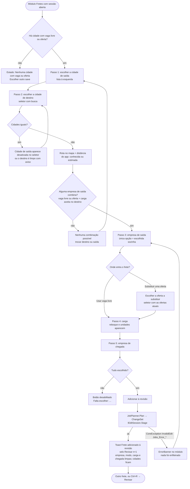
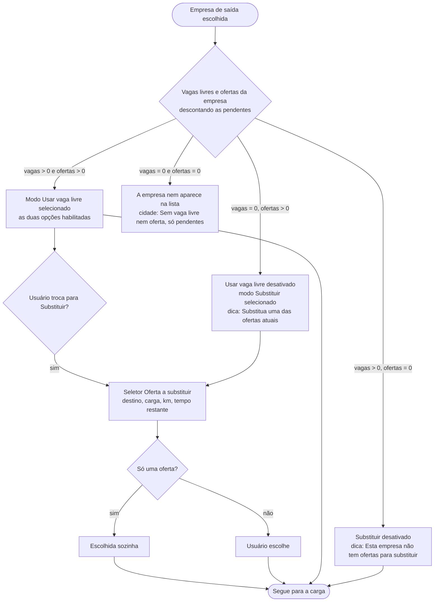
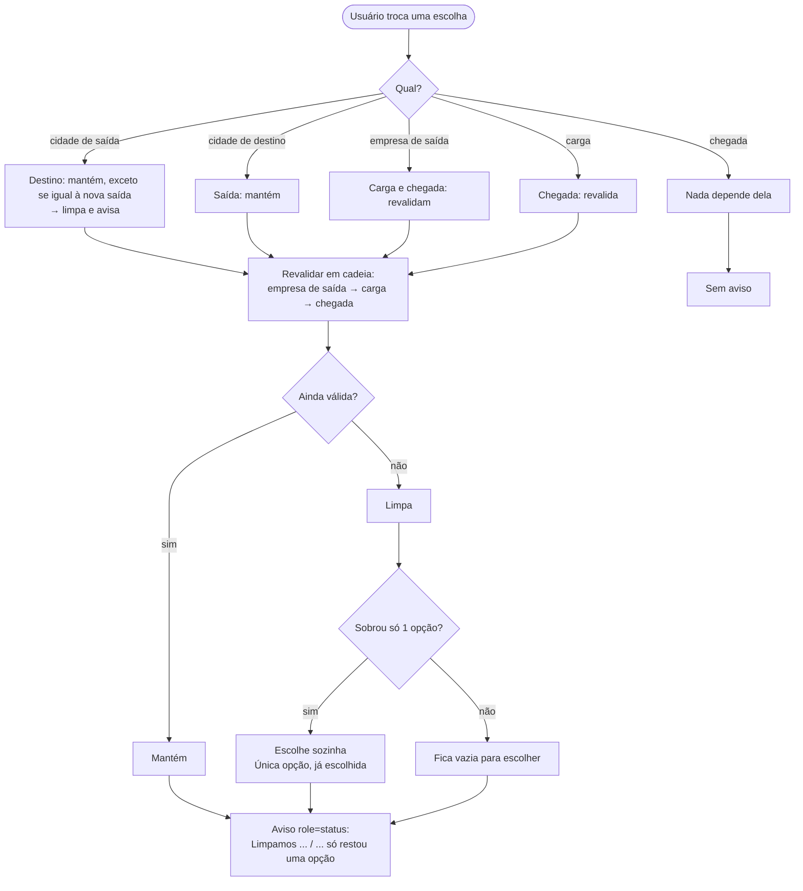
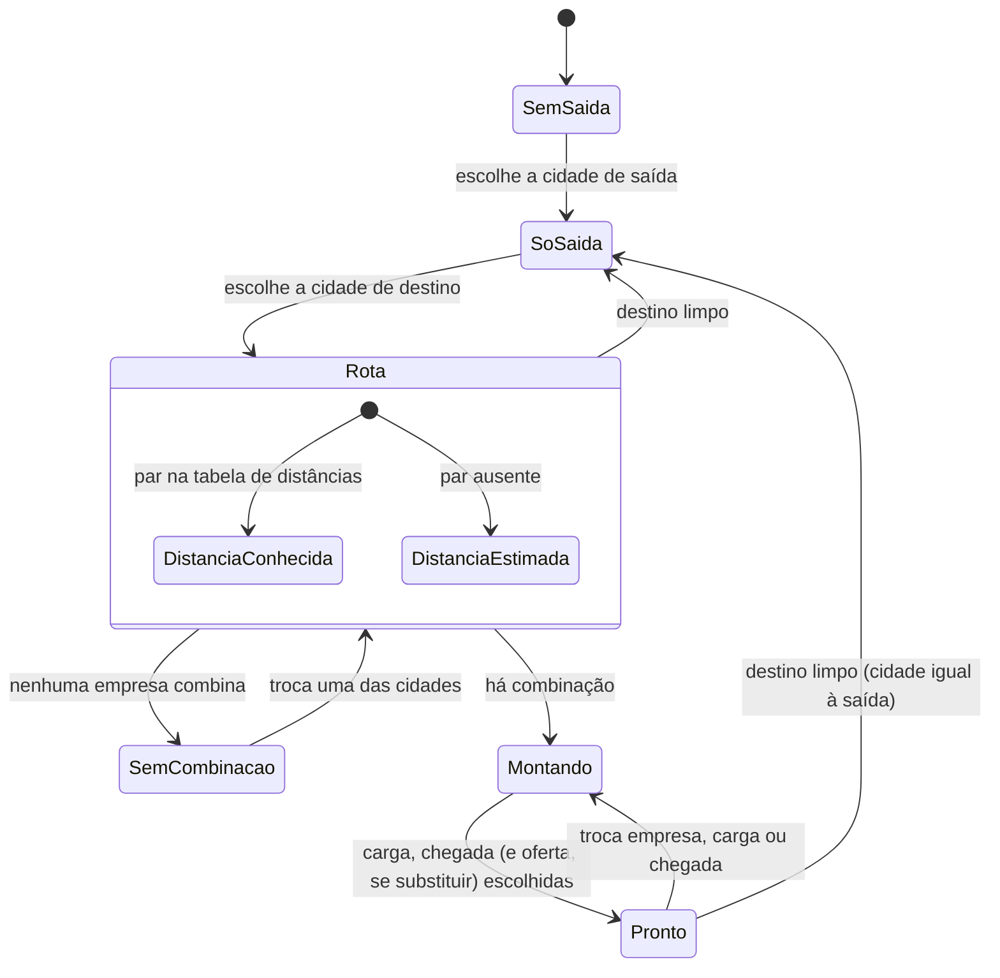
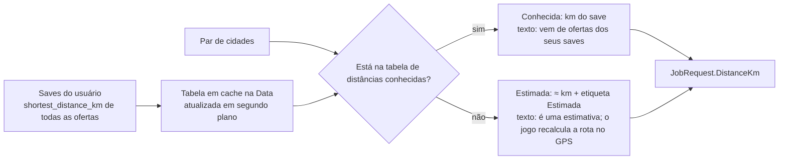
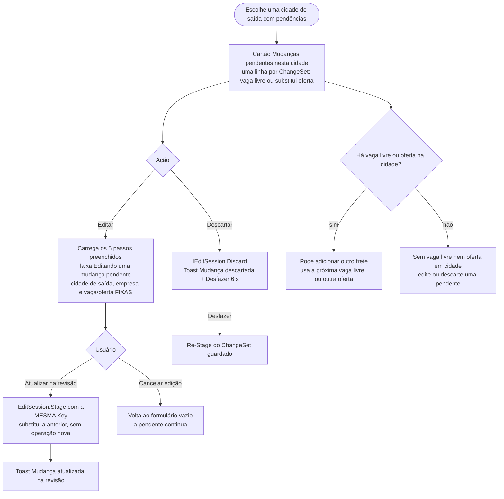
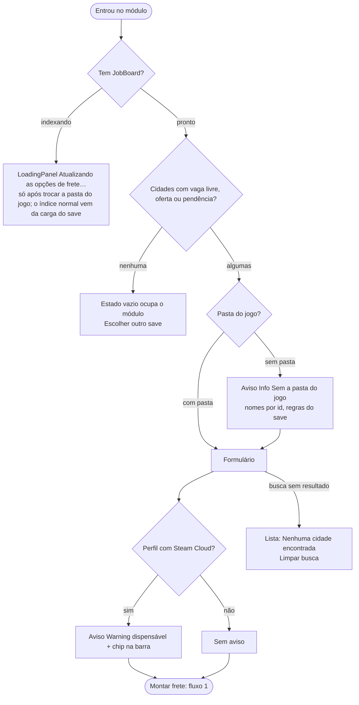
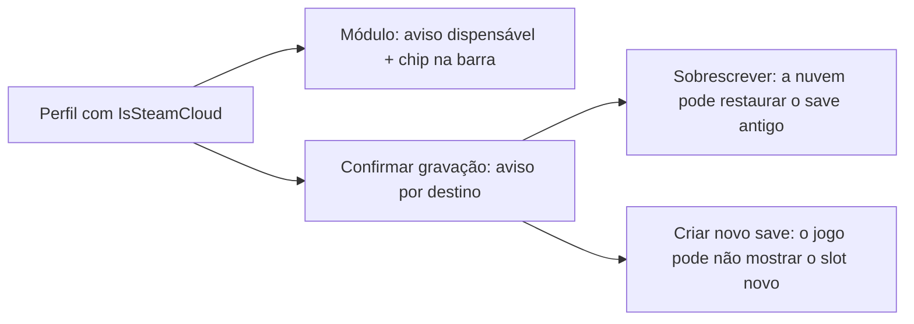

# Fretes — fluxos

Parte do ciclo explorar → **editar** → revisar → aplicar. O módulo cuida de explorar e editar; a revisão e a gravação são do shell (`design/review-apply/`). Nomes entre crases: contratos do plano 0006 (`JobBoard`, `JobRequest`, `JobPlanner`, `ChangeSet`, `IEditSession`).

## 1. Fluxo principal: do primeiro passo à revisão

Notas:
- Cada passo só mostra opções que combinam com os anteriores; os erros `Jobs_Error_*` são a rede de segurança (a sessão mudou, outra mudança pendente tomou a vaga ou a oferta).
- Os passos 1 e 2 podem ser feitos em qualquer ordem; 3 a 5 são sempre depois de 1 e 2, na ordem.
- **O usuário nunca digita a distância**: ela vem do app (§3). Não há passo nem campo para isso.
- Nada é gravado no módulo; "Adicionar" só altera a sessão de edição (pendentes) e o selo da barra.

## 1b. Onde entra o frete (vaga livre ou substituir)

- Vaga livre = slot de oferta vazio (o `ChangeSet` tem `Antes` vazio, "—"). Substituir = o slot da oferta escolhida (o `ChangeSet` tem `Antes` com os valores atuais; a revisão mostra antes → depois).
- Cada pendência usa um slot (uma `Key` por slot): um slot já usado por outra pendência não aparece como vaga nem como oferta.

## 2. Trocar uma escolha anterior

Regra: **cada escolha posterior fica se continua válida; senão é limpa** (e, se sobrar uma única opção, é escolhida sozinha). As cidades não limpam uma à outra, exceto quando ficariam iguais.

| Troca | Mantém | Revalida e pode limpar |
| --- | --- | --- |
| Cidade de saída | cidade de destino (se diferente) | empresa de saída (com modo e oferta), carga, empresa de chegada |
| Cidade de destino | cidade de saída | empresa de saída (com modo e oferta), carga, empresa de chegada |
| Empresa de saída | cidades | modo (volta ao padrão da nova empresa) e oferta, carga, empresa de chegada |
| Carga | cidades, empresa de saída, modo e oferta | empresa de chegada |
| Empresa de chegada | tudo | — |
| Trocar saída e destino (botão) | — | limpa os três (as regras são direcionais) |

A distância é sempre a do par de cidades (conhecida ou estimada) e se recalcula ao mudar uma delas; não há valor a limpar.

## 3. Estados do par de cidades e da distância

Como o app obtém a distância (nunca é digitada):

- Seletor de destino: cidades de distância conhecida primeiro (com "394 km"), depois as de distância estimada (com a etiqueta "Estimada" e "≈ 985 km"); a cidade de saída fica no topo, desativada; "Sem combinação" tem prioridade sobre "Estimada" na etiqueta.
- Mapa e `StatTile` mostram "≈" e "km · estimada" quando estimada; a revisão mostra a distância com o mesmo "≈" (`Format_KmApprox`).

## 4. Mudança pendente para o slot (editar / descartar)

- Editar pode mudar **destino, carga, empresa de chegada e prazo**. O seletor de destino, na edição, mostra só as cidades que a empresa fixa atende. Para trocar a empresa, o modo ou a oferta/vaga, descarte a pendente e crie outra (a `Key` é por slot; reenfileirar com a mesma `Key` é o que substitui).
- A cidade continua na lista enquanto tiver vaga, oferta ou pendência; sem nada disso, sai da lista.

## 5. Estados do módulo

- **Trocar a pasta do jogo com sessão aberta** (Configurações): `IGameDataService.Changed` refaz o `JobBoard` (a tabela de distâncias não depende da pasta); as pendências ficam e o formulário revalida (fluxo 2) com as novas regras e nomes. Nomes e idioma mudam sem reler o save.
- **Trocar o idioma do app**: nomes do jogo são trocados na hora; as escolhas ficam.
- **Falha ao enfileirar**: `CoreException(InvalidEdit)` com `Jobs_Error_*` (ou `Conflict`/`StalePatch` do `Stage`) → `ErrorBanner` no módulo; as escolhas ficam para o usuário corrigir.

## 6. Steam Cloud e gravação

O módulo só informa; a escolha do destino da gravação é na confirmação (`design/review-apply/`).
