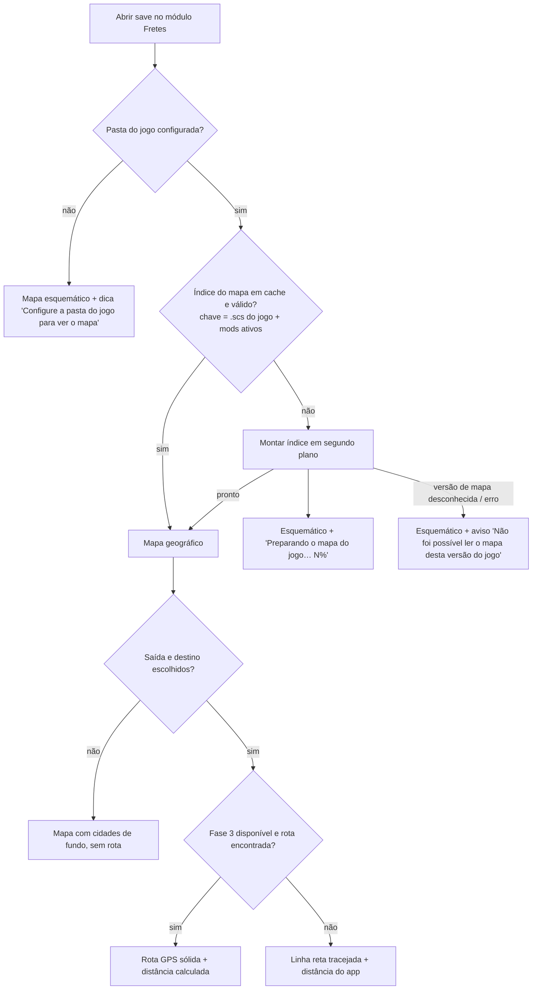

# Mapa do jogo — fluxos

Trocar mods ativos no perfil muda a chave do cache → novo índice na próxima abertura.
Cancelamento: fechar o save cancela a montagem; o que já foi lido não é gravado no cache.
