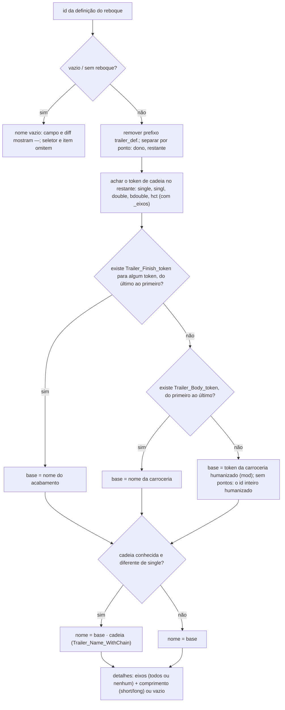
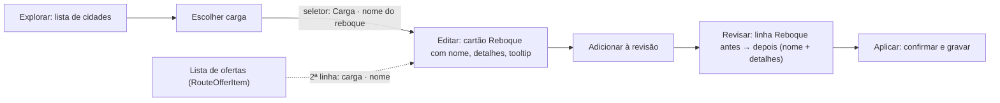
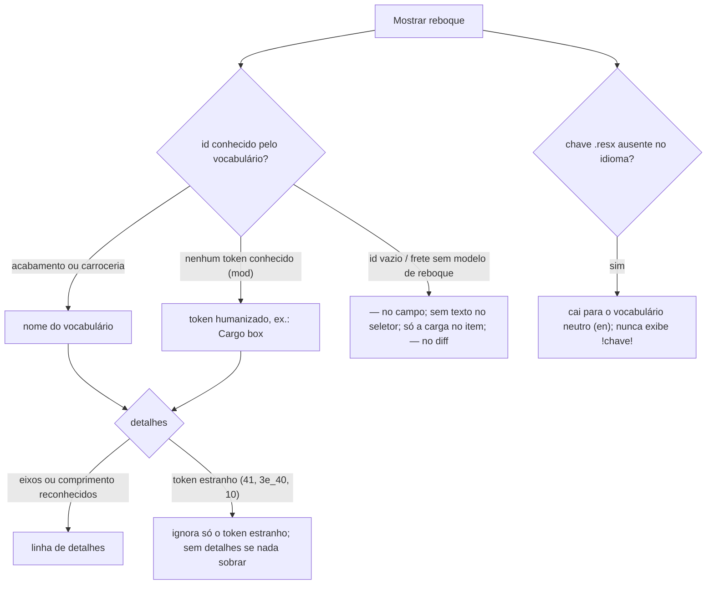
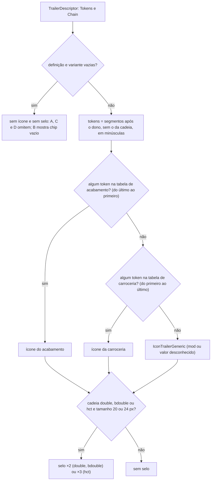
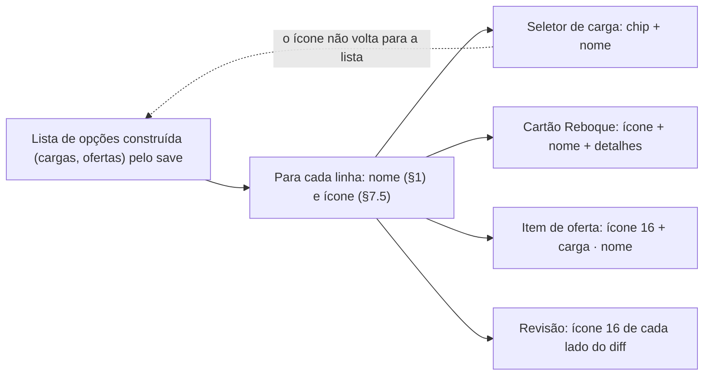

# Nomes de reboque — fluxos

O nome é calculado localmente a partir do id (sem I/O, sem pasta do jogo), então não há estado de carregamento próprio: o nome nasce com o reboque do frete.

## 1. Resolução do nome (regra única, usada por todas as superfícies)

## 2. Ciclo do módulo (onde o nome aparece)

O reboque **não é escolhido pelo usuário**: vem do frete de modelo da carga (`Jobs_Trailer_Help`). Por isso o nome aparece já no seletor de carga (antes de escolher) e se confirma no cartão.

## 3. Caminhos de erro e exceções

Regras de segurança do texto: nenhuma exceção chega à tela; nenhum caminho exibe `!chave!`, `trailer_def.` ou o id cru fora do tooltip.

---

## 4. Ícone do reboque — PROPOSTO

Decoração calculada **depois** da lista de opções. Mesma ordem de tokens do nome (fluxo 1), tabela em [`screens.md`](screens.md) §7.5.

### 4.1 Escolha do ícone

### 4.2 Onde entra no ciclo (e o que ele NÃO faz)

O sentido é único (lista → ícone). Nenhum caminho usa o ícone para filtrar, ordenar, agrupar, habilitar ou buscar (ADR 0003); reboque de mod desconhecido segue na lista com o ícone Genérico.

### 4.3 Casos de borda
| Caso | Resultado |
| --- | --- |
| Id de mod sem token conhecido | Genérico (sem selo se `single`) |
| Mod com cadeia dupla e token de carroceria conhecido (`acme.box.double_2_2.x`) | ícone de baú + selo ×2 |
| Token de acabamento conflita com a carroceria (`box` + `curtain`) | acabamento vence (igual ao nome) |
| Cadeia `singl` (grafia errada) | trata como `single`: sem selo |
| `hct` sem eixos legíveis | selo ×3 mesmo assim (vem da cadeia, não dos eixos) |
| Reboque sem definição, só variante (`trailer.scs_flat_b`) | tenta os tokens da variante; sem nada conhecido, Genérico |
| Frete sem modelo de reboque | sem ícone |
| Ícone pedido por chave que não existe nos recursos | `TrailerIcon` não desenha nada (nunca lança) |
