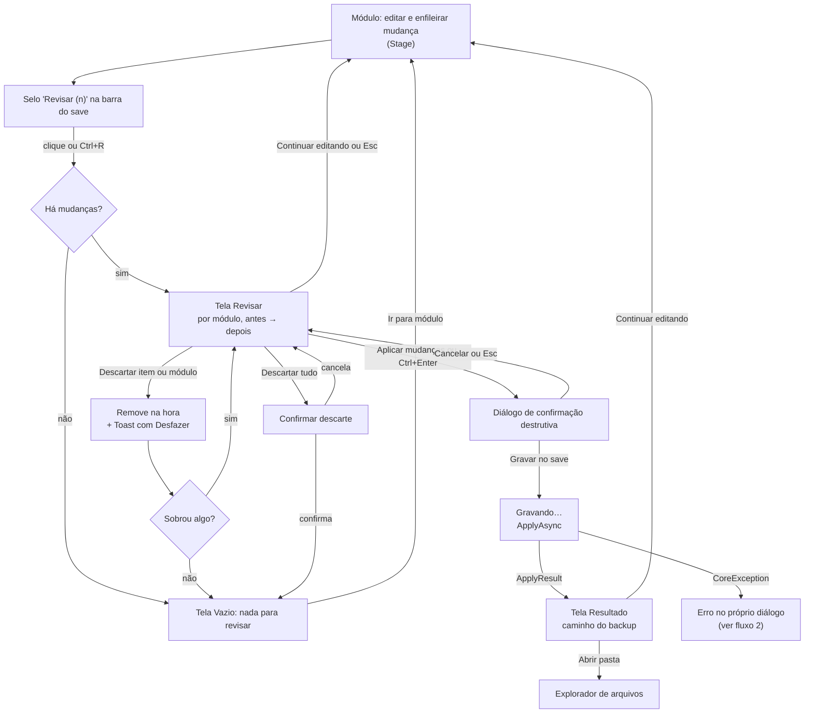
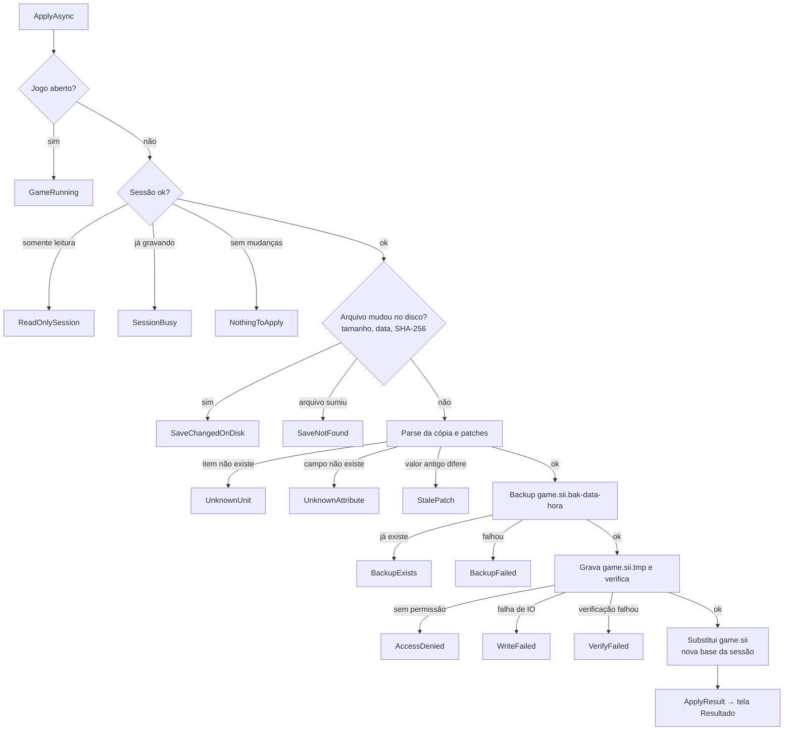
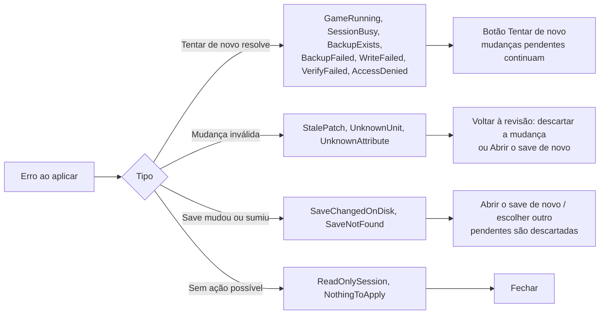
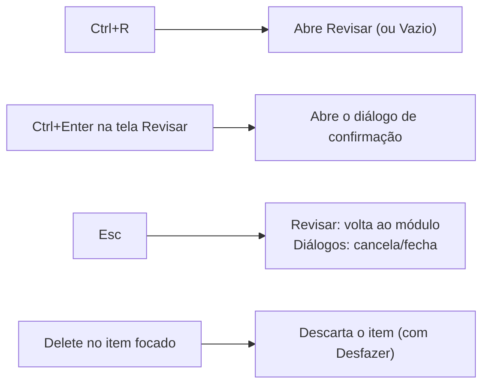

# Revisar e aplicar — fluxos

Parte do ciclo explorar → editar → **revisar → aplicar**. Contratos: ADR 0005
e `docs/architecture/plan-0005-shell.md` (`IEditSession`, `ChangeSet`,
`CoreError`, `ApplyResult`).

## 1. Fluxo principal

Regras do fluxo:
- O selo "Revisar (n)" mostra o número de `ChangeSet`s pendentes. Com 0, o selo
  continua visível (sem número) e leva à tela Vazio.
- Descartar **item** e **módulo** é imediato e reversível (Toast "Desfazer" por
  6 s: a App guarda os `ChangeSet`s descartados e os re-enfileira). Descartar
  **tudo** pede confirmação, porque é a única ação que perde o trabalho todo.
- Depois do sucesso a sessão tem nova base e `Pending` vazio: o selo some o
  número e voltar ao módulo mostra os dados já gravados.

## 2. Aplicar: etapas e onde cada erro aparece

Erros fora do `ApplyAsync` (mesmo vocabulário `CoreError`):
`SaveFormatUnsupported`, `SaveCorrupt`, `SaveNotFound`, `NoSession` ao **abrir** o save (UX-1);
`Conflict`, `StalePatch`, `UnknownUnit`, `UnknownAttribute` ao **enfileirar** (`Stage`) no módulo.

Em todo erro do `ApplyAsync` o save original fica intacto (ADR 0005); a tela
diz isso ("Nada foi gravado. Seu save continua como estava.").

## 3. Recuperação por erro

Detalhes por código estão em `screens.md` (tabela "Erros por CoreError").

## 4. Teclado

`Ctrl+Enter` **não** grava direto: só abre o diálogo. Dentro do diálogo não há
atalho que confirme; o foco inicial fica em **Cancelar**.
