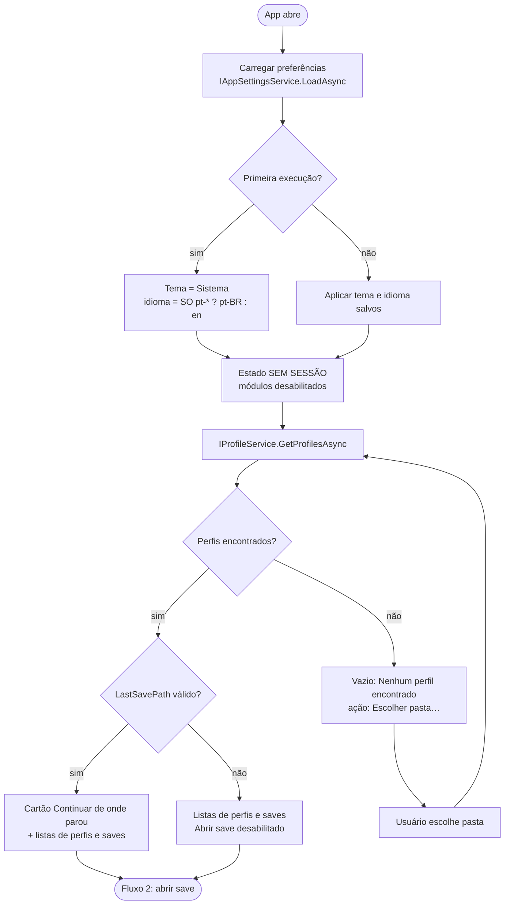
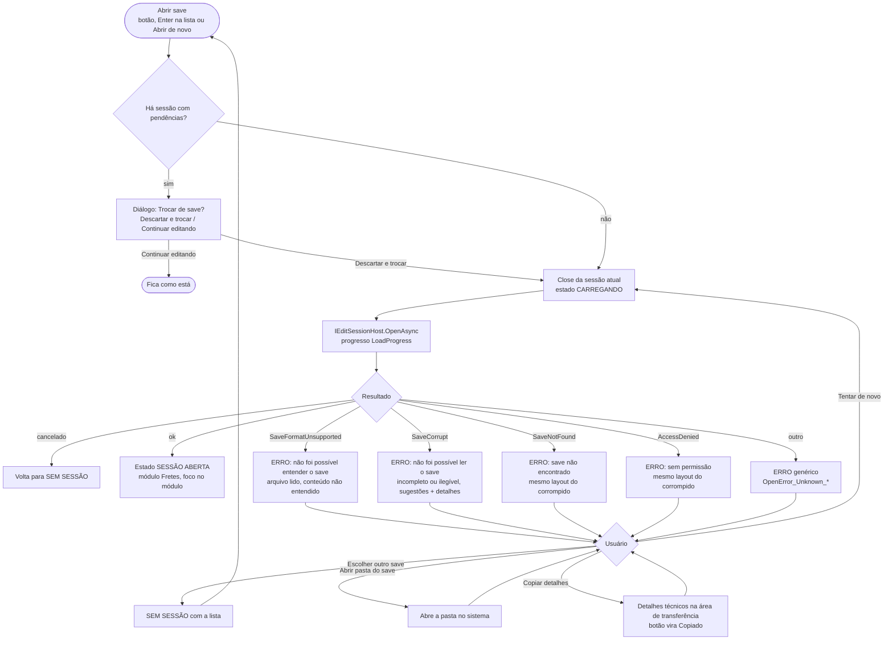
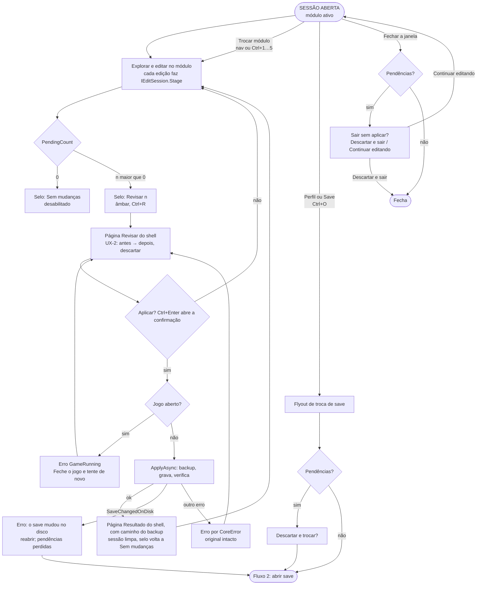
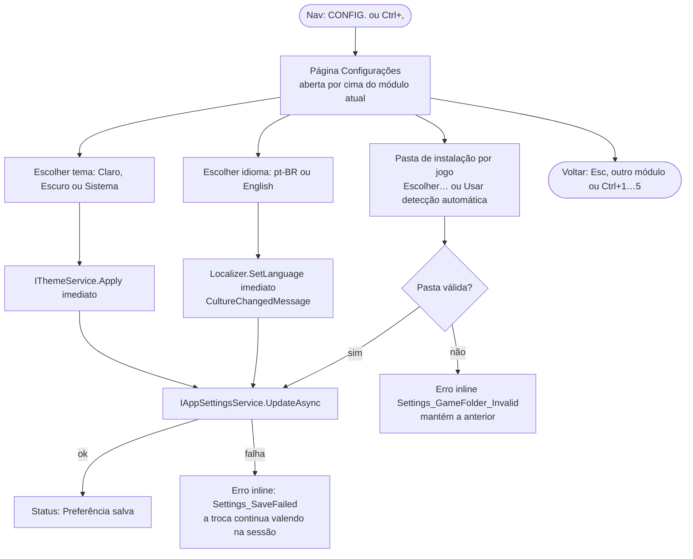
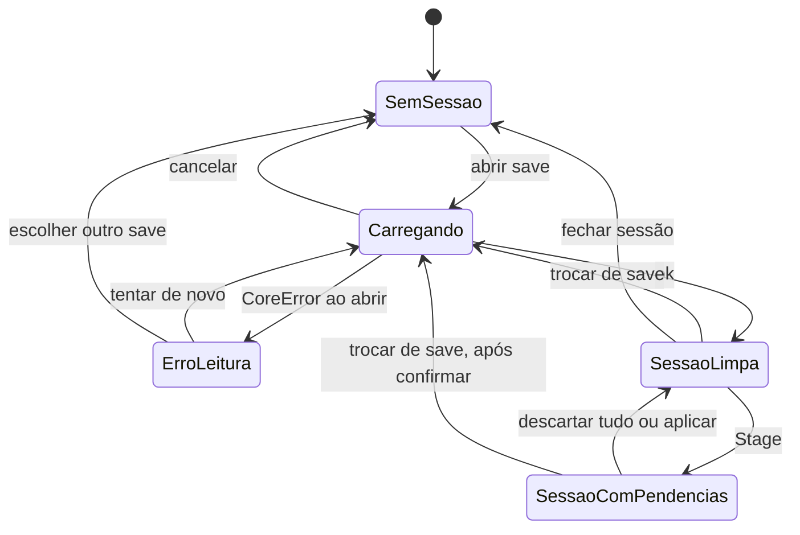

# Fluxos do shell

Ciclo geral: **explorar → editar → revisar → aplicar**. O shell cuida do começo (escolher e abrir o save) e do
fim (revisar/aplicar, em `design/review-apply/`, UX-2); os módulos cuidam de explorar e editar.

Nomes entre crases são os contratos do plano 0005 (`IEditSessionHost`, `CoreError`, `LoadProgress`...).

## 1. Abertura do app

Nada abre sozinho. Configurações está sempre disponível (fluxo 4).

## 2. Abrir um save

Notas:
- Falhou ao abrir: **não há sessão** (aprovado). O arquivo nunca é alterado ao ler.
- "Tentar de novo" relê o **mesmo** arquivo: ajuda depois de o jogo terminar de salvar, de uma permissão resolvida ou de uma
  versão nova do app. Em "não foi possível entender", a ação principal é escolher outro save; só essa tela tem Copiar detalhes.
- Cancelar vale em qualquer ponto de Carregando (`CancellationToken`); volta para Sem sessão.
- O foco vai para o título do erro (leitor de tela anuncia), depois Tab segue a ordem da tela.

## 3. Sessão aberta: do módulo à gravação

Mudar tema ou idioma (fluxo 4) nunca descarta nem altera as pendências.

## 4. Configurações

- Sem botão Salvar nem Cancelar: cada escolha vale na hora e é salva.
- A pasta de instalação (ETS2/ATS) é detectada automaticamente ao abrir o app e quando o usuário clica em "Usar detecção
  automática"; só é salva se a validação passar. Sem pasta, o app funciona igual; só o mapa fica indisponível (uso futuro).
- Abrir Configurações **não** fecha a sessão; o módulo anterior volta como estava (seleção, rolagem).
- Sistema: o app segue o tema do SO em tempo real enquanto estiver nessa opção.

## 5. Estados do shell

| Estado | Navegação | Barra de sessão | Selo | Área principal |
| --- | --- | --- | --- | --- |
| Sem sessão | módulos desabilitados | "Nenhum save aberto" | oculto | Abra um save (ou vazio) |
| Carregando | módulos desabilitados | perfil, save, jogo | oculto | progresso, etapas, Cancelar |
| Erro de leitura | módulos desabilitados | perfil, save (borda de erro), jogo | oculto | tela de erro |
| Sessão aberta, limpa | habilitada | perfil, save, jogo, estado do jogo | "Sem mudanças" (desabilitado) | módulo |
| Sessão aberta, pendências | habilitada | idem | "Revisar (n)" âmbar | módulo |
