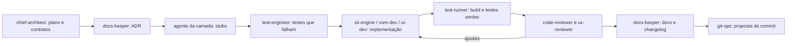

# Fluxo de trabalho com agentes de IA

O desenvolvimento do Own Expeditor usa agentes do Claude Code: subagentes com
um dono por área, skills de workflow (`wf-*`) e scripts do `toolkit/`. Este
documento explica como as peças se encaixam. Não é a fonte de verdade: as
definições ficam em `ia/`.

## Fonte de verdade

| O que | Onde |
| --- | --- |
| Visão geral, tabela de agentes e workflows, regras da orquestração | [ia/README.md](../ia/README.md) |
| Definição de cada agente (modelo, esforço, ferramentas, regras) | [ia/agents/](../ia/agents/) |
| Workflows e skills de apoio | [ia/skills/](../ia/skills/) |
| Scripts que os agentes chamam | [toolkit/](../toolkit/), resumidos em [development.md](development.md#toolkit) |

Em `.claude/agents/` e `.claude/skills/` há links simbólicos para `ia/`. Assim,
o Claude Code encontra as definições sem que elas sejam duplicadas. Um agente
ou skill novo só aparece em sessões iniciadas depois da criação.

## Quem orquestra

A sessão principal é a orquestradora. Ela escolhe o agente, passa o contexto
mínimo (caminhos, contrato e critério de pronto) e repassa o resultado ao
próximo. Subagentes não chamam outros subagentes.

Cada área do código tem um único agente que escreve nela. Por exemplo,
`sii-engine` é dono de `src/OwnExpeditor.Sii`, e `core-dev` de `Domain`, `Core`
e `Data`. Dois agentes que escrevem nunca rodam em paralelo sobre a mesma área.
Os papéis, os modelos e os esforços de cada agente estão na tabela de
[ia/README.md](../ia/README.md).

## Workflows

Cada workflow é uma skill em `ia/skills/wf-*/SKILL.md`. Use o que combina com o
pedido:

| Workflow | Quando usar |
| --- | --- |
| [wf-feature](../ia/skills/wf-feature/SKILL.md) | funcionalidade nova ou mudança que atravessa camadas |
| [wf-bugfix](../ia/skills/wf-bugfix/SKILL.md) | algo quebrado: teste de regressão, depois correção |
| [wf-ui](../ia/skills/wf-ui/SKILL.md) | tela nova ou ajuste visual |
| [wf-refactor](../ia/skills/wf-refactor/SKILL.md) | reorganizar sem mudar comportamento |
| [wf-sii-discovery](../ia/skills/wf-sii-discovery/SKILL.md) | entender ou suportar parte do formato do save |
| [wf-review](../ia/skills/wf-review/SKILL.md) | revisão interna antes do commit |
| [wf-codex-review](../ia/skills/wf-codex-review/SKILL.md) | segunda opinião pelo Codex CLI |
| [wf-docs](../ia/skills/wf-docs/SKILL.md) | atualizar esta documentação |
| [wf-commit](../ia/skills/wf-commit/SKILL.md) | commit, sempre com aprovação do usuário |
| [wf-release](../ia/skills/wf-release/SKILL.md) | exe Windows e notas de versão |

A skill `make-interfaces-feel-better` é usada pelos agentes de UI (ver
[ia/skills/make-interfaces-feel-better/SKILL.md](../ia/skills/make-interfaces-feel-better/SKILL.md)).

## Ciclo de uma feature

Resumo do `wf-feature`. Os detalhes estão na skill:

Mudança pequena, como um bug isolado ou um ajuste visual, pode pular as
primeiras etapas e começar pelos testes.

## Regras que valem para todos os workflows

- Commit só com aprovação explícita do usuário. O `git-ops` prepara a
  proposta, e `toolkit/commit.sh` valida a mensagem antes de commitar.
- Documentação em `docs/` é atualizada pelo `docs-keeper`. Ele não altera código.
- Antes de mudar a leitura ou a escrita do save, a descoberta vai para
  [sii-format.md](sii-format.md), conforme o `CLAUDE.md`.
- Saídas de build e teste são resumidas por `toolkit/check.sh`, para não
  lotar o contexto da sessão principal com log bruto.

## Onde registrar mudanças do processo

Mudanças nos agentes, skills e scripts são commits como qualquer outra. Elas
aparecem no histórico de [changelog.md](changelog.md) quando o commit é
relevante para o estado do projeto.
