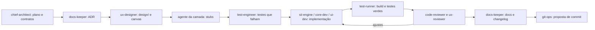

# Fluxo de trabalho com agentes de IA

O desenvolvimento do Own Expeditor usa agentes do Claude Code: subagentes com
um dono por área, skills de workflow (`wf-*`) e scripts do `toolkit/`. Este
documento explica como as peças se encaixam. Não é a fonte de verdade: as
definições ficam em `ia/`.

## Fonte de verdade

| O que | Onde |
| --- | --- |
| Visão geral, tabela de agentes e workflows, regras da orquestração | [ia/README.md](../ia/README.md) |
| Definição de cada agente (modelo, esforço, ferramentas, regras) | [ia/agents/](../ia/agents/) |
| Workflows e skills de apoio | [ia/skills/](../ia/skills/) |
| Scripts que os agentes chamam | [toolkit/](../toolkit/), resumidos em [development.md](development.md#toolkit) |

Em `.claude/agents/` e `.claude/skills/` há links simbólicos para `ia/`. Assim,
o Claude Code encontra as definições sem que elas sejam duplicadas. Um agente
ou skill novo só aparece em sessões iniciadas depois da criação.

## Quem orquestra

A sessão principal é a orquestradora. Ela escolhe o agente, passa o contexto
mínimo (caminhos, contrato e critério de pronto) e repassa o resultado ao
próximo. Subagentes não chamam outros subagentes.

Cada área do código tem um único agente que escreve nela. Por exemplo,
`sii-engine` é dono de `src/OwnExpeditor.Sii`, e `core-dev` de `Domain`, `Core`
e `Data`. Dois agentes que escrevem nunca rodam em paralelo sobre a mesma área.
Os papéis, os modelos e os esforços de cada agente estão na tabela de
[ia/README.md](../ia/README.md).

## Workflows

Cada workflow é uma skill em `ia/skills/wf-*/SKILL.md`. Use o que combina com o
pedido:

| Workflow | Quando usar |
| --- | --- |
| [wf-feature](../ia/skills/wf-feature/SKILL.md) | funcionalidade nova ou mudança que atravessa camadas |
| [wf-bugfix](../ia/skills/wf-bugfix/SKILL.md) | algo quebrado: teste de regressão, depois correção |
| [wf-ui](../ia/skills/wf-ui/SKILL.md) | tela nova ou ajuste visual: passa pelo `ux-designer` antes do `ui-dev` |
| [wf-refactor](../ia/skills/wf-refactor/SKILL.md) | reorganizar sem mudar comportamento |
| [wf-sii-discovery](../ia/skills/wf-sii-discovery/SKILL.md) | entender ou suportar parte do formato do save |
| [wf-review](../ia/skills/wf-review/SKILL.md) | revisão interna antes do commit |
| [wf-codex-review](../ia/skills/wf-codex-review/SKILL.md) | segunda opinião pelo Codex CLI |
| [wf-docs](../ia/skills/wf-docs/SKILL.md) | atualizar esta documentação |
| [wf-commit](../ia/skills/wf-commit/SKILL.md) | commit, sempre com aprovação do usuário |
| [wf-release](../ia/skills/wf-release/SKILL.md) | exe Windows e notas de versão |

## Skills

Skills são instruções que o agente carrega antes de começar. A lista de cada
agente está no topo da sua definição em `ia/agents/`. A tabela abaixo mostra
para que serve cada skill de apoio. O conteúdo fica no `SKILL.md` de cada uma;
aqui há só o resumo.

| Skill | Para quê | Agentes |
| --- | --- | --- |
| [avalonia-polish](../ia/skills/avalonia-polish/SKILL.md) | polimento visual e de interação da UI Avalonia (Fluent); exemplos em `reference.md` | ux-designer, ui-dev, ux-reviewer |
| [avalonia-mvvm](../ia/skills/avalonia-mvvm/SKILL.md) | padrões de View e ViewModel (bindings compilados, comandos assíncronos, DI) | ui-dev, code-reviewer |
| [i18n-theming](../ia/skills/i18n-theming/SKILL.md) | tema Light/Dark/Sistema e idioma pt-BR/en: `.resx`, troca em runtime, preferências | ui-dev, ux-reviewer, chief-architect |
| [design-system](../ia/skills/design-system/SKILL.md) | tokens, componentes de `src/OwnExpeditor.App/Controls` e padrões de tela; reutilize antes de criar | ux-designer, ui-dev, ux-reviewer |
| [ux-writing](../ia/skills/ux-writing/SKILL.md) | textos de interface em pt-BR e en, mensagens de erro e glossário | ui-dev, ux-reviewer, docs-keeper |
| [save-safety](../ia/skills/save-safety/SKILL.md) | regras para ler, gravar ou substituir o `game.sii` (backup, escrita atômica) | sii-engine, core-dev, code-reviewer, chief-architect |
| [ets2-domain](../ia/skills/ets2-domain/SKILL.md) | glossário do save: `company`, `job_offer_data` e demais campos | chief-architect, core-dev, save-inspector, fixture-maker |
| [dotnet-standards](../ia/skills/dotnet-standards/SKILL.md) | convenções C# e .NET 8 (nullable, async, exceções, nomes) | core-dev, sii-engine, test-engineer, build-fixer, code-reviewer |
| [xunit-patterns](../ia/skills/xunit-patterns/SKILL.md) | padrões de teste xUnit: nomes, AAA, fixtures, arquivos temporários | test-engineer, fixture-maker |
| [large-save-performance](../ia/skills/large-save-performance/SKILL.md) | desempenho com saves grandes: medição, alocação, streaming | sii-engine |

Os workflows `wf-*` são skills também, mas ficam na tabela de workflows acima.

## Ciclo de uma feature

Resumo do `wf-feature`. Os detalhes estão na skill:

Mudança pequena, como um bug isolado ou um ajuste visual, pode pular as
primeiras etapas e começar pelos testes. Tela nova ou mudança relevante de UX
não pula o `ux-designer`.

### Design antes de código

Regra do `CLAUDE.md`: nenhuma tela é implementada sem desenho aprovado em
[design/](../design/README.md). O `ux-designer` escreve em `design/<tema>/`
(fluxos, telas, textos e canvas). A sessão principal publica o canvas, e o
usuário aprova. Só então o `ui-dev` implementa, e o `ux-reviewer` compara o
resultado com o desenho aprovado. O agente só escreve em `design/`; ele não
altera código nem docs.

### Evidência visual do ux-reviewer

O `ux-reviewer` não vê a tela rodando. Ele usa `toolkit/screenshots.sh`, que
gera PNGs de cada View em Light/Dark × pt-BR/en, em `.screenshots/` (fora do
git). Os PNGs são a prova de que o código renderiza nos quatro casos. O revisor
compara essas imagens com `design/`. Detalhes do comando em
[development.md](development.md#screenshots-das-telas).

## Regras que valem para todos os workflows

- Commit só com aprovação explícita do usuário. O `git-ops` prepara a
  proposta, e `toolkit/commit.sh` valida a mensagem antes de commitar.
- Documentação em `docs/` é atualizada pelo `docs-keeper`. Ele não altera código.
- Antes de mudar a leitura ou a escrita do save, a descoberta vai para
  [sii-format.md](sii-format.md), conforme o `CLAUDE.md`.
- Saídas de build e teste são resumidas por `toolkit/check.sh`, para não
  lotar o contexto da sessão principal com log bruto.

## Onde registrar mudanças do processo

Mudanças nos agentes, skills e scripts são commits como qualquer outra. Elas
aparecem no histórico de [changelog.md](changelog.md) quando o commit é
relevante para o estado do projeto.
