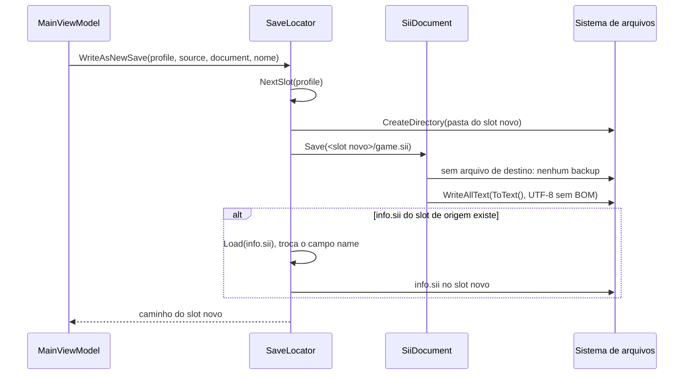

# Fluxo de dados: leitura, escrita e backup

Este documento descreve o que o código faz **hoje**, com os métodos reais de
`src/`. O que ainda não existe está marcado como planejado (ver
[overview.md](overview.md) e a [ADR 0006](../decisions/0006-integracao-do-codigo-de-injecao-ao-shell.md)).

## Localizar perfil e save

`SaveLocator` (`Data`) lista os perfis da pasta de documentos do jogo e os
slots de cada perfil. Só lê pastas e arquivos; não altera nada.

- `Profiles(documentsDir)`: devolve os perfis com `Path`, `Id` e `IsSteamCloud`.
- `Saves(profile)`: devolve os slots com `Folder`, `Slot` e `Name` (lido de `info.sii`).
- `NextSlot(profile)`: próxima pasta de slot livre, usada pela gravação em slot novo.

## Leitura

`SiiDocument.Load(path)` lê o arquivo inteiro e entrega o conteúdo em camadas:

```mermaid
sequenceDiagram
    participant C as Chamador
    participant D as SiiDocument
    participant S as SiiDecoder
    participant B as BsiiDecoder
    C->>D: Load(path)
    D->>D: File.ReadAllBytes(path)
    D->>S: DecodeToText(bytes)
    S->>S: DetectFormat(bytes)
    alt ScsC (criptografado)
        S->>S: Decrypt: AES-256-CBC (IV no offset 36)
        S->>S: zlib descompacta; confere tamanho do cabeçalho (offset 52)
        S->>S: DecodeToText(conteúdo interno)
    else SiiNunit (texto)
        S->>S: UTF-8, aceita BOM
    else BSII (binário)
        S->>B: ToText(bytes)
        B-->>S: texto SiiNunit
    else 3nK
        S->>S: Decode3nK (XOR), depois DecodeToText
    else outro
        S-->>C: InvalidDataException
    end
    S-->>D: texto SiiNunit
    D->>D: Parse(texto)
    D-->>C: SiiDocument com Units
```

Pontos relevantes de `Parse`:

- Linhas em branco são ignoradas. O cabeçalho precisa ser `SiiNunit`, senão
  lança `InvalidDataException` com número da linha.
- Cada bloco é `tipo : id {`. Um bloco sem `}` gera erro no fim do arquivo.
- Atributos são divididos no **primeiro** `": "`, então valores com `: ` dentro
  (ex.: `name: "a: b"`) ficam inteiros.
- `Find(id)` usa um índice por ID. Se houver IDs repetidos, vale o primeiro.
  `Units` mantém todos. `OfType(tipo)` filtra por tipo.

Leitura de BSII: `BsiiDecoder.ToText` devolve texto `SiiNunit`, com os nomes
dos campos e a forma dos valores iguais aos de um save que o jogo gravou em
texto. Formato em [../sii-format.md](../sii-format.md), seção 8.

### Definições do jogo e nomes

`GameCatalog.LoadFromGameDir(gameDir, language)` (`Data`) lê `def.scs`,
`dlc_*.scs` e `locale.scs` da instalação do jogo, pelo leitor `HashFsArchive`.
Ele monta empresas, cidades, cargas e reboques e as regras de carga. Os nomes
passam por `Localization`, que resolve `@@chave@@` no idioma escolhido.
O idioma vem de `Localization.GameLanguage(documentsDir)` (`g_lang_init` do
`config.cfg`) ou, sem isso, da cultura da UI.

Pelo `SaveSession` (`Core`), a sessão recebe o `SiiDocument` e o `GameCatalog`
e monta as opções a partir do save. Detalhes em
[../sii-format.md](../sii-format.md), seções 4 e 9.

## Escrita

Hoje, a única escrita da UI é criar um save novo com
`SaveLocator.WriteAsNewSave(profile, source, document, name)`:



`SiiDocument.Save(path)` grava o texto e, **só se o arquivo já existe**, copia
antes o original para `path.bak-yyyyMMdd-HHmmss` (`File.Copy` com
`overwrite: false`). Como o slot novo não tem `game.sii`, não há backup. O
save original não é tocado.

Detalhes importantes:

- O nome do backup usa a hora local com precisão de segundo. Se já existir um
  backup com o mesmo nome (duas gravações no mesmo segundo), `File.Copy` lança
  exceção e **nada é gravado**. Isso protege o save, mas a operação falha.
- O backup é cópia byte a byte do arquivo original, então restaurar é copiá-lo
  de volta por cima de `game.sii`. O app não tem comando de restauração.
- A escrita não usa `game.sii.tmp` nem verificação. Isso é o que a ADR 0006
  (item 5) muda.
- Ao gravar, o arquivo passa a ser texto `SiiNunit`, mesmo que o original fosse
  ScsC ou BSII. Ver [ADR 0002](../decisions/0002-gravar-save-em-texto.md).
- Com `ToText()` sem alterações, o resultado deve ser idêntico ao texto lido.
  Testado com `RealSaveTests` contra os saves de `samples/`. Ver
  [../development.md](../development.md).

### Escrita planejada (ADR 0006, item 5)

Na confirmação, o usuário escolhe o destino. Os dois caminhos passam por um
único `ApplyAsync(ApplyTarget)` e pela Data (`ISaveFileStore`):

- **Sobrescrever este save** (padrão): cria backup `game.sii.bak-<timestamp>`,
  grava `game.sii.tmp`, verifica e substitui o original.
- **Criar um novo save**: copia a pasta do slot para o próximo slot livre, grava
  o `game.sii` alterado ali (mesmas etapas `.tmp` e verificação) e ajusta o nome
  em `info.sii`. O original não é tocado. Com Steam Cloud, o jogo pode não
  mostrar o slot.

> TODO: confirmar cada etapa quando `ApplyAsync` e `ISaveFileStore` forem
> implementados (plano 0006, fases F3 e F4).

## Ordem exigida pelo `CLAUDE.md`

1. Nunca gravar sem backup ao lado (`game.sii.bak-<timestamp>`). Hoje está em
   `SiiDocument.Save`, mas só quando o arquivo de destino existe. O slot novo não
   tem original, então esta regra não se aplica a ele como está escrito.
   TODO: confirmar como a regra vale para "criar um novo save" (ADR 0006 não
   diz explicitamente; o plano diz que o original não é tocado).
2. Round-trip sem mudanças gera arquivo equivalente. Coberto por teste
   (`RealSaveTests`).

Quando a escrita passar por `ApplyAsync`, a regra deve ser garantida pelo
`Core`, para que a UI nunca chame `Save` sem o backup. Hoje a UI chama
`SaveLocator.WriteAsNewSave` direto.

## Caveats do parser e do writer

Estes comportamentos vêm do código. Quando não estão cobertos pelos testes, a
linha é marcada.

- Linhas são `Trim()`-adas. Espaços no início ou no fim de um valor se perdem.
- Atributo com valor vazio escrito como `nome:` (sem espaço) é gravado como
  `nome: ` (com espaço). O texto muda, mas o valor não. TODO: confirmar se o
  jogo gera esse formato.
- Cabeçalho de bloco sem espaços ao redor do `:` (ex.: `tipo:id {`) é rejeitado
  com erro de cabeçalho inválido. TODO: confirmar se o jogo gera esse formato.
- Um arquivo ScsC truncado, com tamanho que não é múltiplo de 16, pode lançar
  `CryptographicException` em vez de `InvalidDataException`, porque a
  descriptografia usa `PaddingMode.None`.
- Erros de leitura ainda são `InvalidDataException`, sem o tipo
  `SiiFormatException`/`SiiErrorKind` da ADR 0006 (planejado).
