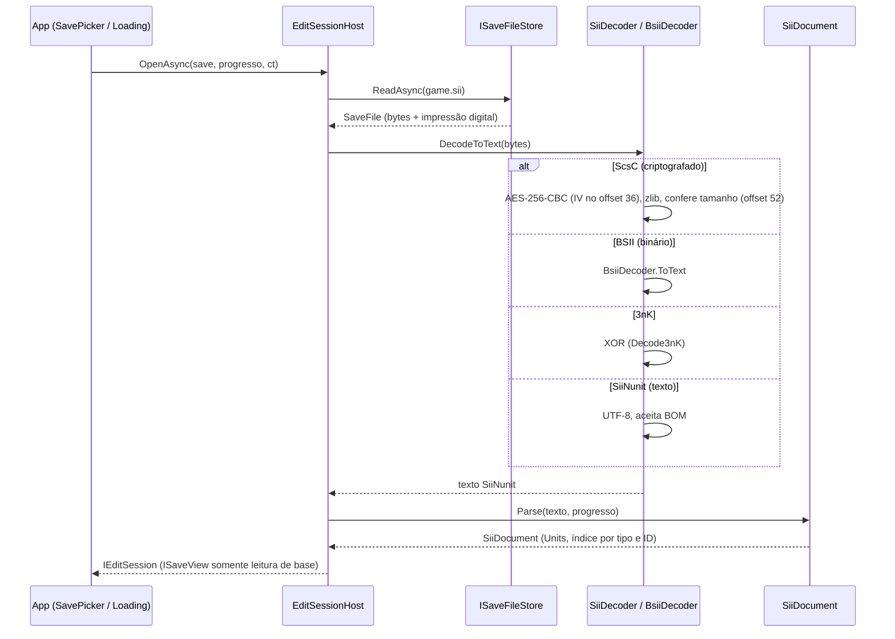
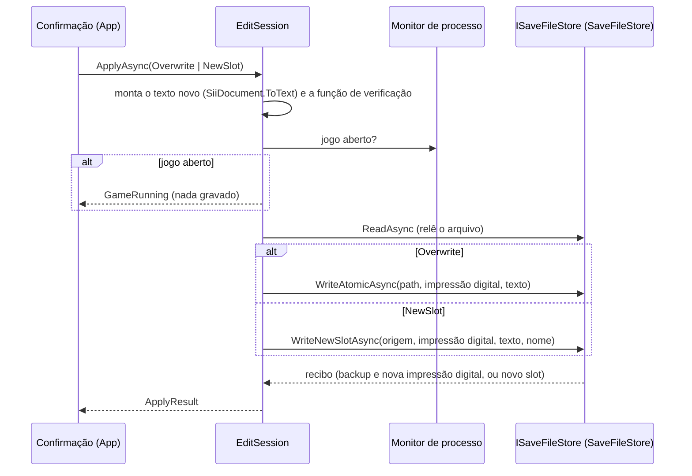

# Fluxo de dados: leitura, escrita e backup

Este documento descreve o que o código faz **hoje**, com os métodos reais de
`src/`. A visão geral está em [overview.md](overview.md).

## Localizar perfil e save

`ProfileLocator` (`Data`, interface `IProfileLocator`) procura perfis em
Documentos, em `~/.local/share` (Linux nativo) e no prefixo Proton da Steam.
Lê `profiles/` e `steam_profiles/` (este último com Steam Cloud). Só lê pastas e
arquivos; não altera nada.

`ProfileService` (`Core`, `IProfileService`) expõe o resultado à App:

- `GetProfilesAsync()` devolve os perfis (`ProfileInfo`).
- `GetSavesAsync(profile)` devolve os slots (`SaveSlotInfo`), lendo o nome de
  `info.sii`.

## Leitura e abertura da sessão

`IEditSessionHost.OpenAsync(save, progress, ct)` (`Core`) abre o save. Só uma
sessão existe por vez; abrir outro save fecha a anterior.

Estágios de progresso (`LoadStages`, chaves `Loading_Stage_*`): leitura do
arquivo, interpretação do save e organização dos fretes e empresas. A tela de
carregamento aceita cancelamento.

Erros de leitura viram `CoreError` por `CoreErrors.FromRead`:

- `SaveCorrupt`: arquivo danificado ou truncado (`SiiErrorKind` `Empty`,
  `Truncated`, `DecryptFailed`, `DecompressFailed`, `SizeMismatch`).
- `SaveParseFailed`: conteúdo não reconhecido ou fora do formato
  (`UnknownFormat`, `UnsupportedVersion`, `UnknownValueType`, `Syntax`).
- `SaveNotFound` e `AccessDenied`: erro de arquivo ou permissão.

Detalhes do parser: `SiiDocument.Parse` lança `SiiFormatException` com
`Line` ou `Offset` quando houver. Caveats estão no fim deste documento.

### Opções de frete

`JobBoard` (`Core/Modules/Jobs`) é um índice só de leitura sobre a `ISaveView`
(que já inclui as pendências) e o `IGameData` do jogo. Ele responde na ordem do
fluxo da tela: cidade de saída, cidade de destino, empresa de saída, carga e
empresa de chegada. As regras de carga são o catálogo do jogo mais as regras
reveladas pelas ofertas do save (para mods, sem catálogo, só as do save).

A distância vem de `DistanceTable`: primeiro o par conhecido (das ofertas de
todos os saves do usuário, via `IDistanceCache`), depois a estimativa pelo grafo
de pares conhecidos. Ver [../sii-format.md](../sii-format.md), seção 10.

### Cache de distâncias

`JsonDistanceCache` (`Data/Distances`, `IDistanceCache`) guarda, por jogo, a tabela
agregada em `distances-ets2.json` ou `distances-ats.json`, na pasta de ajustes
(`SettingsDirectory`, padrão `%AppData%\OwnExpeditor` no Windows). Ele também
guarda a impressão digital (tamanho e data) de cada save já lido, para reler só o
que mudou. `ScanAsync` lê os saves informados em segundo plano; saves ilegíveis
são pulados. A gravação do cache é feita por `.tmp` e troca. Falha de disco não
derruba o app.

## Planejar e revisar

Cada ação de módulo (por exemplo, adicionar um frete) monta um `ChangeSet`:

- `JobPlanner.Plan(original, board, request)` valida o pedido (cidades
  diferentes, prazo válido, empresa e carga compatíveis, vaga livre ou oferta
  existente) e devolve um `ChangeSet` de `SetAttribute`. A `Key` é
  `jobs:slot:<id>`, então editar uma pendência substitui a anterior.
- Violação vira `CoreException(InvalidEdit)` com `Reason = Jobs_Error_*`. Nada é
  gravado.
- `IEditSession.Stage(change)` confere os valores antigos (`OldValue`) contra o
  save base. Se não baterem, `StalePatch`.

Pendências ficam na sessão. `Discard(id)`, `DiscardModule(id)` e `DiscardAll()`
desfazem sem tocar no arquivo. O shell mostra as pendências de todos os módulos
na revisão.

## Gravação

`IEditSession.ApplyAsync(ApplyTarget, ct)` grava todas as pendências de uma vez.
`ApplyTarget` é `Overwrite` ou `NewSlot(nome)`. Só uma gravação por vez
(`SessionBusy`).

### Sobrescrever (`WriteAtomicAsync`)

1. **Confere** que o arquivo ainda é o que foi lido (tamanho e SHA-256). Se mudou,
   `SaveChangedOnDisk`, e nada é gravado.
2. **Backup**: copia `game.sii` para `game.sii.bak-yyyyMMdd-HHmmss` ao lado, com
   `overwrite: false`, e confere o tamanho. Se o nome já existe, `BackupExists`;
   se a cópia falhar, a cópia parcial é apagada e a gravação não acontece.
3. **Grava em `game.sii.tmp`**: texto UTF-8 sem BOM, com `Flush(true)`.
4. **Relê e verifica**: o conteúdo relido tem de ser igual aos bytes gravados e
   passar pela verificação da sessão (mesma contagem de blocos e os valores novos
   presentes). Se falhar, `VerifyFailed`.
5. **Troca**: `File.Move(tmp, game.sii, overwrite: true)`.

Se qualquer etapa falhar depois do backup, o `.tmp` é apagado e o original
continua como estava. O backup fica na pasta, com o nome acima.

### Novo save (`WriteNewSlotAsync`)

1. **Confere** o save de origem, como acima.
2. **Aloca** a próxima pasta de slot livre do perfil (`SlotUnavailable` se não
   houver ou se a pasta não puder ser criada).
3. **Copia** a pasta de origem inteira para o slot novo.
4. **Grava** o `game.sii` alterado no slot novo, com as mesmas etapas `.tmp` e
   verificação.
5. **Renomeia** o nome em `info.sii` para o nome escolhido (até 40 caracteres).

O save original não é tocado e não há `.bak`, porque a cópia nunca altera a
origem. Se uma etapa falhar, a pasta do slot novo é apagada. Ver a nota sobre o
`CLAUDE.md` abaixo.

### Formato gravado

Ao gravar, o arquivo passa a ser texto `SiiNunit`, mesmo que o original fosse
ScsC ou BSII ([ADR 0002](../decisions/0002-gravar-save-em-texto.md)). Com
`ToText()` sem alterações, o resultado é idêntico ao texto lido: coberto pelo
teste de round-trip (`RealSaveTests`, `JobsRealSaveTests`) contra os saves de
`samples/`.

Erros de gravação viram `CoreError` por `SaveWriteException`
(`SaveWriteFailure`): `ChangedOnDisk`, `BackupExists`, `BackupFailed`,
`WriteFailed`, `VerifyFailed`, `AccessDenied`, `NotFound`, `SlotUnavailable`.

## Regras do `CLAUDE.md` e como o código as cumpre

1. **Nunca gravar sem backup ao lado.** `SaveFileStore.WriteAtomicAsync` cria o
   backup antes de qualquer escrita. O novo save não tem backup porque não altera
   o original; a regra não está escrita para esse caso.
   > TODO: confirmar com o `chief-architect` se "criar um novo save" dispensa o
   > `.bak` ou se ele também deve gerar um backup do `game.sii` de origem.
2. **Round-trip sem mudanças gera arquivo equivalente.** Coberto por teste.

Toda gravação passa por `ISaveFileStore`, chamado só por `EditSession.ApplyAsync`.
A UI não tem caminho próprio de escrita.

## Caveats do parser e do writer

Estes comportamentos vêm do código. Quando não estão cobertos pelos testes, a
linha é marcada.

- Linhas são `Trim()`-adas. Espaços no início ou no fim de um valor se perdem.
- Atributo com valor vazio escrito como `nome:` (sem espaço) é gravado como
  `nome: ` (com espaço). O texto muda, mas o valor não.
  > TODO: confirmar se o jogo gera esse formato.
- Cabeçalho de bloco sem espaços ao redor do `:` (ex.: `tipo:id {`) é rejeitado
  com erro de sintaxe.
  > TODO: confirmar se o jogo gera esse formato.
- Um arquivo ScsC truncado, com tamanho que não é múltiplo de 16, é classificado
  como `DecryptFailed` (`SaveCorrupt`), e não mais como exceção de criptografia.
- Blocos e atributos duplicados: `Find(id)` devolve o primeiro. `Units` mantém
  todos.
