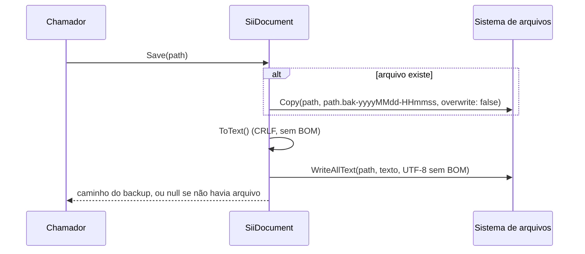

# Fluxo de dados: leitura, escrita e backup

Este documento descreve o que o código faz **hoje**, com os métodos reais de
`src/OwnExpeditor.Sii`. As etapas de perfil, listagem e injeção ainda não têm
código (ver [overview.md](overview.md)).

## Leitura

`SiiDocument.Load(path)` lê o arquivo inteiro e entrega o conteúdo em camadas:

```mermaid
sequenceDiagram
    participant C as Chamador
    participant D as SiiDocument
    participant S as SiiDecoder
    C->>D: Load(path)
    D->>D: File.ReadAllBytes(path)
    D->>S: DecodeToText(bytes)
    S->>S: DetectFormat(bytes)
    alt ScsC (criptografado)
        S->>S: Decrypt: AES-256-CBC (IV no offset 36)
        S->>S: zlib descompacta; confere tamanho do cabeçalho (offset 52)
        S->>S: DecodeToText(conteúdo interno)
    else SiiNunit (texto)
        S->>S: UTF-8, aceita BOM
    else BSII ou 3nK
        S-->>C: NotSupportedException
    else outro
        S-->>C: InvalidDataException
    end
    S-->>D: texto SiiNunit
    D->>D: Parse(texto)
    D-->>C: SiiDocument com Units
```

Pontos relevantes de `Parse`:

- Linhas em branco são ignoradas. O cabeçalho precisa ser `SiiNunit`, senão
  lança `InvalidDataException` com número da linha.
- Cada bloco é `tipo : id {`. Um bloco sem `}` gera erro no fim do arquivo.
- Atributos são divididos no **primeiro** `": "`, então valores com `: ` dentro
  (ex.: `name: "a: b"`) ficam inteiros.
- `Find(id)` usa um índice por ID. Se houver IDs repetidos, vale o primeiro.
  `Units` mantém todos.

## Escrita

`SiiDocument.Save(path)` faz o backup antes de sobrescrever:



Detalhes importantes:

- O backup é cópia byte a byte do arquivo original, então restaurar é copiá-lo
  de volta por cima de `game.sii`. O app não tem comando de restauração.
- O nome usa a hora local com precisão de segundo. Se já existir um backup com
  o mesmo nome (duas gravações no mesmo segundo), `File.Copy` lança exceção e
  **nada é gravado**. Isso protege o save, mas a operação falha.
- Ao gravar, o arquivo passa a ser texto `SiiNunit`, mesmo que o original fosse
  ScsC. Ver [ADR 0002](../decisions/0002-gravar-save-em-texto.md).
- Com `ToText()` sem alterações, o resultado deve ser idêntico ao texto lido.
  Testado com `RealSaveTests` contra os saves de `samples/`. Ver
  [../development.md](../development.md).

## Ordem exigida pelo `CLAUDE.md`

1. Nunca gravar sem backup ao lado (`game.sii.bak-<timestamp>`). Está em `Save`.
2. Round-trip sem mudanças gera arquivo equivalente. Coberto por teste.

Quando o `Core` existir, a regra deve ser garantida por ele, para que a UI
nunca chame `Save` sem o backup. Hoje a garantia está só em `Sii`.

## Caveats do parser e do writer

Estes comportamentos vêm do código. Quando não estão cobertos pelos testes, a
linha é marcada.

- Linhas são `Trim()`-adas. Espaços no início ou no fim de um valor se perdem.
- Atributo com valor vazio escrito como `nome:` (sem espaço) é gravado como
  `nome: ` (com espaço). O texto muda, mas o valor não. TODO: confirmar se o
  jogo gera esse formato.
- Cabeçalho de bloco sem espaços ao redor do `:` (ex.: `tipo:id {`) é rejeitado
  com erro de cabeçalho inválido. TODO: confirmar se o jogo gera esse formato.
- Um arquivo ScsC truncado, com tamanho que não é múltiplo de 16, pode lançar
  `CryptographicException` em vez de `InvalidDataException`, porque a
  descriptografia usa `PaddingMode.None`.
