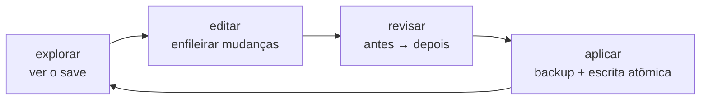

# Visão geral da arquitetura

O Own Expeditor é um editor de jobs (fretes) para Euro Truck Simulator 2 e
American Truck Simulator. Em vez de criar ofertas do zero, ele **substitui
ofertas que já existem** no save (`game.sii`) pela origem, destino, carga e
reboque escolhidos pelo usuário. A ideia vem do Virtual Speditor.

## Camadas

```mermaid
flowchart TD
    App["OwnExpeditor.App<br/>UI Avalonia (MVVM)"]
    Core["OwnExpeditor.Core<br/>casos de uso"]
    Data["OwnExpeditor.Data<br/>perfis, saves, .scs, catálogo"]
    Sii["OwnExpeditor.Sii<br/>ScsC, BSII, parser/writer SiiNunit"]
    Domain["OwnExpeditor.Domain<br/>entidades puras (vazio hoje)"]

    App --> Core
    App -.->|records puros, planejado (ADR 0005)| Domain
    Core --> Data
    Core --> Sii
    Core --> Domain
    Data --> Sii
    Data --> Domain
    Sii --> Domain
```

As setas apontam para a dependência. A linha pontilhada é planejada: hoje a App
referencia só o `Core`. Detalhes de cada projeto em [layers.md](layers.md).

## Fluxo principal

O fluxo que o app precisa cumprir, na ordem:

1. **Ler save**: localizar `game.sii` do perfil e decodificá-lo até texto
   `SiiNunit` (ScsC, BSII ou texto puro).
2. **Listar opções**: montar origens, destinos, cargas e reboques a partir do
   próprio save e do catálogo lido dos pacotes `.scs` do jogo.
3. **Injetar job**: trocar uma oferta existente pela combinação escolhida.
4. **Gravar**: criar um save novo com o texto alterado (hoje) ou sobrescrever
   o save com backup (planejado).

Estado atual de cada etapa:

| Etapa | Situação |
|-------|----------|
| Localizar perfil e saves | Implementada em `SaveLocator` (`Data`): lista perfis e slots e escolhe o próximo slot livre |
| Decodificar ScsC, BSII e texto | Implementada em `SiiDecoder` e `BsiiDecoder` (`Sii`). `3nK` ainda não é lido |
| Parsear e gravar texto | Implementada em `SiiDocument` (`Sii`), com round-trip |
| Ler definições do jogo (`.scs`) | Implementada em `HashFsArchive`, `CityHash` (`Data/Scs`) e `GameCatalog` (`Data`) |
| Nomes do jogo (locale) | Implementada em `Localization` (`Data`), lida a partir de `locale.scs` |
| Listar opções | Implementada em `SaveSession` (`Core`): origens, cargas, destinos e distâncias |
| Injetar job | Implementada em `SaveSession.Inject` e `JobInjector` (`Core`), com a tela única de `MainViewModel` (`App`) |
| Gravar | Só como **save novo**, em `SaveLocator.WriteAsNewSave` (`Data`), sem `.tmp` nem verificação. Sobrescrever não existe |
| Backup antes de gravar | Feito em `SiiDocument.Save`, só quando o arquivo de destino já existe. Um slot novo não tem original para copiar. TODO: confirmar como a regra do `CLAUDE.md` se aplica ao slot novo |

## Shell modular (planejado)

O app deve virar um shell com módulos (Fretes primeiro, depois Caminhões,
Perfil, Empresa e Mapa). Todos seguem o mesmo ciclo:



- **Explorar e editar** ficam no módulo. Ele não grava nada: monta
  `ChangeSet`s numa sessão de edição do `Core`.
- **Revisar, aplicar e ver o resultado** ficam no shell e valem para todos os
  módulos. Uma gravação cobre todas as mudanças pendentes, com um único backup.
- **Aplicar** é atômico: confere se o jogo está fechado e se o arquivo não
  mudou, grava `game.sii.tmp`, verifica e só então substitui o original.
- Na confirmação, o usuário escolhe o destino: **Sobrescrever este save**
  (padrão) ou **Criar um novo save**. Ver a [ADR 0006](../decisions/0006-integracao-do-codigo-de-injecao-ao-shell.md), item 5.

Decisões: [ADR 0005](../decisions/0005-shell-modular-e-sessao-de-edicao.md) (shell
e sessão de edição) e [ADR 0006](../decisions/0006-integracao-do-codigo-de-injecao-ao-shell.md)
(integração do código de injeção ao shell).
Plano de implementação e tarefas: [plan-0005-shell.md](plan-0005-shell.md) e
[plan-0006-integracao.md](plan-0006-integracao.md).

Estado: o shell e a sessão de edição ainda não existem. O que existe hoje é a
tela única de `MainViewModel`, que usa `SaveSession` e `JobInjector` direto.
> TODO: confirmar a implementação de cada item do plano 0005 e do plano 0006
> antes de descrever o comportamento como fato.

## Integração planejada (ADR 0006)

O código que funciona no jogo fica onde está. Mudam as fronteiras:

- `SaveSession` vira `JobBoard`, um índice só de leitura; `JobInjector` vira
  `JobPlanner`, que devolve um `ChangeSet` em vez de alterar o documento.
- Os erros de leitura passam a ser tipados (`SiiFormatException` com
  `SiiErrorKind` no Sii; `CoreError` no Core).
- Os nomes do jogo passam pelo Core (`IGameNames`), não pela App.
- A App chega ao save só pelo `Core`. Hoje ela já referencia só o `Core`.
- A ordem de entrega está nas fases F0 a F7 do plano 0006.
> TODO: confirmar cada item quando a fase correspondente for mergeada.

## Requisitos transversais: tema e idioma

A UI precisa oferecer tema Light, Dark ou Sistema, e os idiomas pt-BR e en. A
regra está no `CLAUDE.md` e na decisão
[ADR 0004](../decisions/0004-suporte-a-tema-e-idioma.md). Em cada camada:
textos ficam em `.resx` na App, o Core devolve códigos de erro e a Data guarda
as preferências. Detalhes por camada em [layers.md](layers.md).

| Item | Situação |
|------|----------|
| Tema segue o sistema | Implementado: `App.axaml` usa `RequestedThemeVariant="Default"` |
| Escolha de tema Light/Dark pelo usuário | TODO: confirmar. Não há tela nem preferência |
| Textos em `.resx` (pt-BR e en) | TODO: confirmar. Não há arquivos `.resx` (planejado: plano 0006, F5) |
| Preferências em JSON, na Data | TODO: confirmar. Não há código de configurações em `Data` |
| Troca de tema e idioma em runtime | TODO: confirmar. Depende dos itens acima |
| Nomes do jogo na língua do app | Planejado (ADR 0006, item 2). Hoje o idioma vem do `config.cfg` do jogo |

Sequência detalhada de leitura e escrita: [data-flow.md](data-flow.md).
Formato do arquivo: [../sii-format.md](../sii-format.md).
