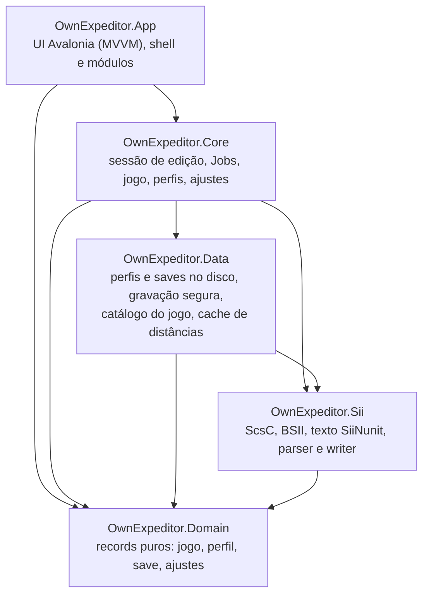

# Visão geral da arquitetura

O Own Expeditor é um editor de jobs (fretes) para Euro Truck Simulator 2 e
American Truck Simulator. Em vez de criar ofertas do zero, ele **substitui
ofertas que já existem** no save (`game.sii`) pela origem, destino, carga e
reboque escolhidos pelo usuário. A ideia vem do Virtual Speditor.

O app sempre abre o **shell modular**: uma janela com módulos (hoje só Fretes é
real), uma sessão de edição por save e uma revisão única para gravar tudo de
uma vez. Não há mais o caminho antigo de tela única.

## Camadas

As setas apontam para a dependência. A App referencia só `Core` e `Domain`
(`DisableTransitiveProjectReferences` impede que `Data` e `Sii` entrem por
transitividade). Detalhes de cada projeto em [layers.md](layers.md).

## Fluxo principal

O fluxo que o app cumpre, na ordem:

1. **Achar perfis e saves**: `IProfileService` (`Core`) lista perfis e slots pela
   `ProfileLocator` (`Data`), em Documentos, `~/.local/share` e Proton.
2. **Abrir o save**: `IEditSessionHost.OpenAsync` (`Core`) lê o arquivo, decodifica
   para texto `SiiNunit` (ScsC, BSII ou texto) e indexa o save. O progresso chega
   à tela de carregamento.
3. **Listar opções**: `JobBoard` (`Core/Modules/Jobs`) responde, só para leitura,
   quais cidades, empresas, cargas e reboques valem, com as regras do catálogo do
   jogo (`GameCatalog`, `Data`) e as que o próprio save revela.
4. **Planejar mudanças**: `JobPlanner` transforma a escolha em um `ChangeSet` de
   patches (`SetAttribute`). Nada é alterado ainda. A sessão guarda o `ChangeSet`
   como pendência.
5. **Revisar**: o shell mostra antes → depois de todas as pendências, de todos os
   módulos.
6. **Aplicar**: `IEditSession.ApplyAsync(ApplyTarget)` gera o texto novo e chama o
   `ISaveFileStore` (`Data`), que faz backup, grava em `.tmp`, verifica e troca o
   arquivo. O destino é **Sobrescrever este save** (padrão) ou **Criar um novo
   save**.

Sequência detalhada de leitura e escrita: [data-flow.md](data-flow.md).

## Estado de cada etapa

| Etapa | Onde | Situação |
|-------|------|----------|
| Localizar perfis e saves | `ProfileLocator` (`Data`), `ProfileService` (`Core`) | Implementada: Windows, Linux nativo, Proton e Steam Cloud (`steam_profiles`) |
| Decodificar ScsC, BSII, texto e 3nK | `SiiDecoder`, `BsiiDecoder` (`Sii`) | Implementada. Erros tipados (`SiiFormatException`, `SiiErrorKind`) |
| Parsear e gravar texto | `SiiDocument` (`Sii`) | Implementada, com round-trip. `Save` foi removido: a gravação passa por `SaveFileStore` |
| Ler definições do jogo (`.scs`) | `HashFsArchive`, `CityHash`, `GameCatalog` (`Data`) | Implementada. Nomes pelo `locale.scs` (`Localization`) |
| Nomes do jogo na língua do app | `IGameNames` (`Core`) | Implementada |
| Nome e ícone do reboque | `TrailerDescriptor` (`Domain`), `TrailerText` e `TrailerIcons` (`App`) | Implementada: lidos do id da definição, sem lista fixa ([ADR 0008](../decisions/0008-nomes-e-icones-de-reboque.md)) |
| Opções de frete | `JobBoard`, `DistanceTable` (`Core/Modules/Jobs`) | Implementada. Distância conhecida ou estimada |
| Cache de distâncias | `JsonDistanceCache` (`Data/Distances`) | Implementada: `distances-ets2.json` e `distances-ats.json` na pasta de ajustes |
| Planejar mudança de frete | `JobPlanner` (`Core/Modules/Jobs`) | Implementada. Substitui `JobInjector` |
| Revisar e desfazer pendências | `EditSession`, `ChangeSet` (`Core/Session`) | Implementada, com `Stage`, `Discard`, `DiscardModule`, `DiscardAll` |
| Gravar (sobrescrever ou novo save) | `EditSession.ApplyAsync` → `SaveFileStore` (`Data`) | Implementada. Backup, `.tmp`, verificação e troca atômica |
| Backup antes de gravar | `SaveFileStore` | Feito a cada sobrescrita. Um novo save copia a pasta de origem e não cria `.bak` (ver [data-flow.md](data-flow.md)) |
| Configurações (tema, idioma, pasta do jogo) | `IAppSettingsService` (`Core`), `JsonSettingsStore` (`Data`) | Implementada |

## Shell e módulos

- O shell (`ShellViewModel`, `ShellView`) tem a barra de sessão, a barra lateral
  de módulos e a revisão. Os módulos são descritos por `ModuleDescriptor` e
  ligados às Views pelo `ViewRegistry`.
- **Fretes** (`JobsPageViewModel`, `JobsView`) é o módulo real. Frota, Perfil,
  Empresa e Mapa são espaços reservados (`ModulePlaceholderViewModel`).
- A sessão de edição vive no `Core` e é uma por vez (`EditSessionHost`). Trocar
  de save ou sair com pendências pede confirmação.
- Gravação e erros: cada etapa de `ApplyAsync` mapeia falhas para um `CoreError`
  (por exemplo `GameRunning`, `SaveChangedOnDisk`, `BackupFailed`, `VerifyFailed`),
  e a App traduz para a mensagem `Error_*` do `.resx`.

Decisões: [ADR 0005](../decisions/0005-shell-modular-e-sessao-de-edicao.md) (shell
modular e sessão de edição) e [ADR 0006](../decisions/0006-integracao-do-codigo-de-injecao-ao-shell.md)
(integração do código de injeção ao shell). O plano de implementação está em
[plan-0005-shell.md](plan-0005-shell.md) e [plan-0006-integracao.md](plan-0006-integracao.md)
(fases F0 a F7 concluídas).

## Requisitos transversais: tema e idioma

A UI oferece tema Claro, Escuro ou Sistema, e os idiomas pt-BR e en. A regra
está no `CLAUDE.md` e na [ADR 0004](../decisions/0004-suporte-a-tema-e-idioma.md).

| Item | Situação |
|------|----------|
| Tema Claro, Escuro ou Sistema, escolhido pelo usuário | Implementado (`ThemeService`, `ThemePreference`) |
| Textos em `.resx` (pt-BR e en) | Implementado: `Resources/Strings*.resx`, gerados por `toolkit/gen/gen-resx.py` a partir de `design/` |
| Preferências em JSON | Implementado: `settings.json` na pasta de ajustes (`JsonSettingsStore`) |
| Troca de tema e idioma em runtime | Implementado: idioma sem reiniciar |
| Nomes do jogo na língua do app | Implementado: resolvidos pelo Core (`IGameNames`), com a tradução do `locale.scs`. Reboques leem o id e usam o vocabulário `Trailer_*` do `.resx` ([ADR 0008](../decisions/0008-nomes-e-icones-de-reboque.md)) |

Em cada camada: textos ficam em `.resx` na App; o Core devolve códigos de erro
(`CoreError`) e chaves de texto, nunca frases de UI; a Data guarda as
preferências. Detalhes em [layers.md](layers.md).

> TODO: confirmar no jogo a troca de idioma dos nomes de cidades e cargas com
> `locale.scs` real (plano 0006, risco 6).
