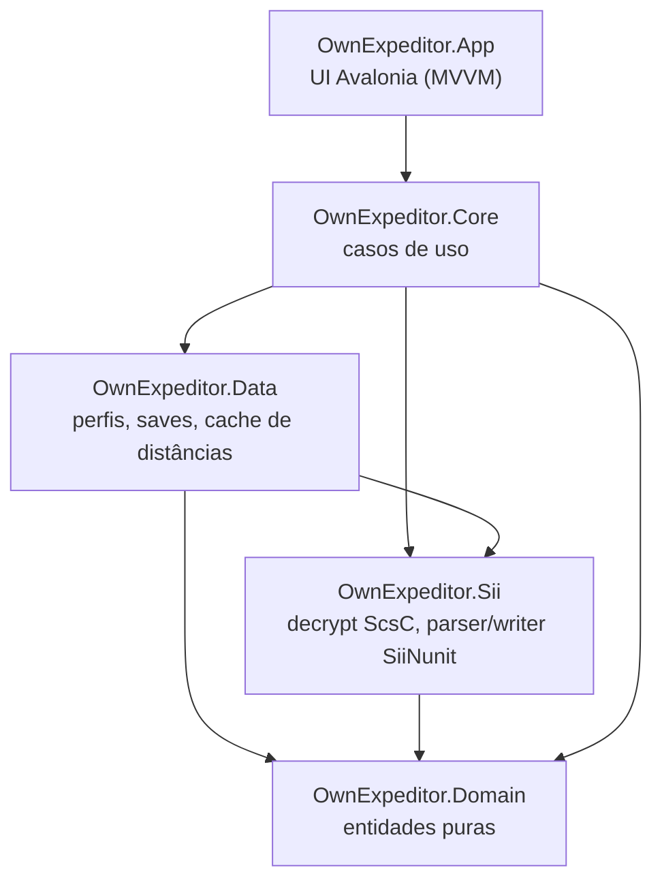

# Visão geral da arquitetura

O Own Expeditor é um editor de jobs (fretes) para Euro Truck Simulator 2 e
American Truck Simulator. Em vez de criar ofertas do zero, ele **substitui
ofertas que já existem** no save (`game.sii`) pela origem, destino, carga e
reboque escolhidos pelo usuário. A ideia vem do Virtual Speditor.

## Camadas

As setas apontam para a dependência. Detalhes de cada projeto em
[layers.md](layers.md).

## Fluxo principal

O fluxo que o app precisa cumprir, na ordem:

1. **Ler save**: localizar `game.sii` do perfil e decodificá-lo até texto
   `SiiNunit`.
2. **Listar opções**: montar origens, destinos, cargas e reboques a partir do
   próprio save.
3. **Injetar job**: trocar uma oferta existente pela combinação escolhida.
4. **Gravar**: criar backup e gravar o save novo.

Estado atual de cada etapa:

| Etapa | Situação |
|-------|----------|
| Decodificar ScsC até texto | Implementada em `SiiDecoder` (`Sii`) |
| Parsear e gravar texto | Implementada em `SiiDocument` (`Sii`), com round-trip |
| Backup antes de gravar | Implementado em `SiiDocument.Save` |
| Localizar perfil e save | TODO: confirmar. Não há código em `Data` |
| Listar opções | TODO: confirmar. Não há código em `Core` |
| Injetar job pela UI | TODO: confirmar. A UI é só o template |

## Requisitos transversais: tema e idioma

A UI precisa oferecer tema Light, Dark ou Sistema, e os idiomas pt-BR e en. A
regra está no `CLAUDE.md` e na decisão
[ADR 0004](../decisions/0004-suporte-a-tema-e-idioma.md). Em cada camada:
textos ficam em `.resx` na App, o Core devolve códigos de erro e a Data guarda
as preferências. Detalhes por camada em [layers.md](layers.md).

| Item | Situação |
|------|----------|
| Tema segue o sistema | Implementado: `App.axaml` usa `RequestedThemeVariant="Default"` |
| Escolha de tema Light/Dark pelo usuário | TODO: confirmar. Não há tela nem preferência |
| Textos em `.resx` (pt-BR e en) | TODO: confirmar. Não há arquivos `.resx` |
| Preferências em JSON, na Data | TODO: confirmar. Não há código em `Data` |
| Troca de tema e idioma em runtime | TODO: confirmar. Depende dos itens acima |

Sequência detalhada de leitura e escrita: [data-flow.md](data-flow.md).
Formato do arquivo: [../sii-format.md](../sii-format.md).
