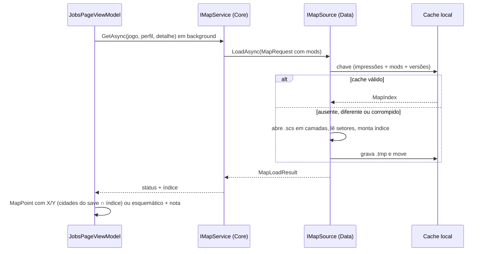

# 0007. Mapa do jogo com rota tipo GPS na tela de Fretes

- Status: aceita
- Data: 2026-11-18
- Desenho: [`design/mapa-jogo/`](../../design/mapa-jogo/README.md)

## Contexto

- A tela de Fretes (`Modules/Jobs/JobsView.axaml`) fixa `RouteMap` em `Mode="Schematic"`. Mostra dois pontos ligados por uma curva. O `RouteCanvas` já tem um modo geográfico: normaliza `MapPoint.Longitude/Latitude` e desenha `Cities`. Hoje ninguém fornece coordenadas: `JobsPageViewModel.View.cs` cria `new MapPoint(nome)`.
- `def/city/*.sii` não tem posição. Posições e estradas estão nos setores binários `map/<mapa>/secXXXXYYYY.{base,aux,snd,data}`, dentro de `base*.scs`, `dlc_*.scs` e dos mods. Os itens que interessam são City (área + token), Company (prefab + token), Road e Prefab, que ligam Nodes. A navegação dentro dos prefabs está nos `.ppd`. O formato tem versão e muda nas versões maiores do jogo.
- As coordenadas x/z estão em metros do mundo, e a projeção plana (x, −z) basta. O km mostrado pelo jogo aplica escala (~1:19 na estrada, ~1:3 na cidade).
- O que já existe:
  - Na Data, `HashFsArchive` (só HashFS v2) e `GameCatalogSource`, que guarda cache por nome/tamanho/data, mas só lê `def.scs`, `dlc_*.scs` e `locale.scs`.
  - No Core, `DistanceTable` (km conhecidos do save + menor caminho).
  - Nada lê mods. As fontes seriam `active_mods[]` do `profile.sii`, `<Documentos>/<jogo>/mod/*.scs|*.zip` e o Workshop (`227300`/`270880`). Mods de mapa trocam ou acrescentam setores por prioridade e vêm em zip ou HashFS v1.
- Custo: são milhares de setores. Ler tudo leva segundos e passa por centenas de MB.
- (?) Os itens de setor parecem não ter tamanho próprio. Se for assim, para achar os City o leitor precisa saber pular todos os tipos de item daquela versão. É isso que define o custo real da fase 1, e precisa ser confirmado antes de qualquer código.

## Decisão

O app desenha um **mapa vetorial próprio** com os dados da instalação do usuário, em fases. Cada fase entrega algo por si só e, quando falta dado, a tela volta ao esquemático.

0. **Descoberta (nenhum código de produto).** Antes do parser, documentar em `docs/scs-map-format.md` (mesma regra do `sii-format.md`):
   - cabeçalho e versão dos setores;
   - layout de City, Company, Node, Road e Prefab;
   - se dá para pular itens desconhecidos;
   - como achar o mapa (`map/*.mbd`, sem nome fixo) e quais `.scs` têm `map/`;
   - tempo e memória medidos numa instalação real.
1. **1a — Cidades do jogo base + DLC.**
   - `MapSectorReader`, escrito por versão suportada, extrai City (centro da área) e Company.
   - Versão desconhecida devolve `UnsupportedVersion`; nunca sobe exceção para a UI.
   - A tela de Fretes passa a `Mode="Auto"`: rota geográfica quando as duas cidades têm posição.
   - Fundo = cidades **do save** que têm posição. Nada de lista fixa nem de cidade de DLC que o save não tem.
2. **1b — Mods.**
   - Localizar os pacotes de `active_mods` (pasta `mod/` e Workshop) e ler zip e HashFS v1.
   - Montar um sistema de arquivos em camadas: mod de maior prioridade, depois DLC, depois base.
   - Os contratos já recebem a lista de mods desde a 1a (entra na chave do cache), então a 1b não muda assinaturas.
   - Por que separar da 1a: zip, HashFS v1, Workshop e ordem de prioridade são quatro fontes de bug, e não devem segurar o ganho no jogo base. Até a 1b, cidade de mod sem posição cai no esquemático. É degradação, não lista fixa.
3. **Fase 2 — Estradas de fundo.**
   - Polilinhas simplificadas (Douglas–Peucker por nível de detalhe), com classe (autoestrada, principal, local, balsa).
   - O `RouteCanvas` ganha zoom e arrastar, com geometria em cache por nível e matriz de transformação no arrasto.
   - Exige desenho aprovado em `design/mapa-jogo/`: tokens `MapRoad*` Light/Dark e controle por teclado.
4. **Fase 3 — Rota GPS.**
   - A Data entrega um grafo compacto: nós de grau 2 contraídos; arestas com comprimento em metros, escala e polilinha.
   - O Core roda A* (heurística euclidiana) de empresa a empresa, partindo de Company até o nó mais próximo.
   - 3a: cada prefab conta como ligação total entre seus nós.
   - 3b: curvas do `.ppd`, com sentido. Só se a diferença para `shortest_distance_km` justificar.
   - A distância calculada é **só informativa** (aparece ao lado da do job). Gravar essa distância ou usá-la no `DistanceTable` exige outro ADR.

Vale para todas as fases:

- **Cache em disco.**
  - Índice compacto (`MapIndex`) em binário próprio (magic + versão de esquema), em `LocalApplicationData/OwnExpeditor/cache/map/`.
  - Gravado em `.tmp` + move. Se estiver corrompido ou a chave não bater, é descartado e reconstruído.
  - Chave = versão do esquema + versão do formato do mapa + impressão (nome/tamanho/data) de cada `.scs` lido + mods ativos, em ordem, com a impressão de cada um.
  - Guardar só os N mais recentes por jogo.
- **Carga em background** no `IMapService`, com progresso e cancelamento (troca de save ou de jogo). A tela abre esquemática e passa a geográfica quando o índice chega.
- **Origem dos dados.** Só a instalação e os documentos do usuário, lidos em runtime. Nenhum asset ou cache derivado vai para o repositório, os testes ou o instalador. As fixtures são setores sintéticos montados à mão. Testes com instalação real são opcionais (pulados sem variável de ambiente).
- **ts-map.** Só como referência de formato, e só depois de verificar a licença. Nenhum código copiado.
- **Save.** O mapa nunca toca o save e nada aqui passa por `ApplyAsync`.

Alternativas descartadas:

- Imagens do mapa exportadas do jogo, ou tiles de terceiros: redistribuem asset da SCS, não acompanham DLC, mods nem versão e pesam no instalador.
- Tabela fixa de coordenadas: viola o ADR 0003 e quebra com mods e DLC novas.
- Serviço online de mapa ou rotas: depende de rede e de terceiros, não conhece os mods do usuário e manda dados do perfil para fora.
- Posições inferidas dos km do save (MDS sobre o `DistanceTable`): não parece um mapa e sai com rotação/espelho arbitrários. Fica só como ideia de fallback sem pasta do jogo.
- Usar um parser pronto (ts-map) como dependência: licença incerta e preso ao ciclo de versões de outro projeto.
- Grafo e A* na Data: regra de negócio fica no Core; a Data só entrega dados.
- Ler os setores a cada abertura: segundos de espera e centenas de MB lidos de novo.

## Contratos

```csharp
// Domain/Maps (sem dependências)
public readonly record struct MapPos(float X, float Z);            // metros do mundo; tela usa (X, -Z)
public sealed record MapCity(string Token, MapPos Center);
public sealed record MapCompany(string CompanyToken, string CityToken, MapPos Position, int? NodeId);
public enum MapRoadClass { Motorway, Main, Local, Ferry }
public sealed record MapPolyline(MapRoadClass Class, int Lod, IReadOnlyList<MapPos> Points);
public sealed record MapEdge(int From, int To, float LengthM, float Scale, MapRoadClass Class, int Polyline);
public sealed record MapGraph(IReadOnlyList<MapPos> Nodes, IReadOnlyList<MapEdge> Edges);
public sealed record MapIndex(IReadOnlyList<MapCity> Cities, IReadOnlyList<MapCompany> Companies,
    IReadOnlyList<MapPolyline> Roads, MapGraph? Graph);
public enum MapStatus { Ready, NoGameFolder, UnsupportedVersion, PartiallyRead, Failed }

// Data/Maps
public enum MapDetail { Cities, Roads, Graph }
public sealed record ModPackage(string Name, string Path, int Priority);
public sealed record MapRequest(GameKind Game, string InstallDir, IReadOnlyList<ModPackage> Mods, MapDetail Detail);
public sealed record MapLoadResult(MapStatus Status, MapIndex? Index, IReadOnlyList<string> SkippedMods);
public interface IMapSource
{ Task<MapLoadResult> LoadAsync(MapRequest request, IProgress<double>? progress, CancellationToken ct); }
public interface IModLocator { IReadOnlyList<ModPackage> Active(ProfileInfo profile); }   // 1a devolve []
internal interface IScsFileSystem { Stream? Open(string path); IEnumerable<string> List(string dir); } // camadas

// Core/Maps
public interface IMapService
{
    Task<MapLoadResult> GetAsync(GameKind game, ProfileInfo profile, MapDetail detail, CancellationToken ct);
    event EventHandler<GameKind>? Changed;                       // pasta do jogo ou mods mudaram
}
public sealed record RoutePlan(IReadOnlyList<MapPos> Path, int EstimatedKm, int? JobKm);
public interface IRoutePlanner { RoutePlan? Plan(MapIndex map, string fromCompany, string toCompany); } // "<empresa>.<cidade>"

// App
public sealed record MapPoint(string Label, double? X = null, double? Y = null);  // era Longitude/Latitude; Y = -Z
// RouteMap/RouteCanvas: + Roads e zoom/pan (fase 2), + RoutePath (fase 3)
```

## Fluxo



## Plano por camadas

Cada item: agente — arquivos — pronto quando.

- **Fase 0**
  1. `sii-engine` — `docs/scs-map-format.md` — layout, versão, regra para pular itens, medição; aprovado pelo usuário.
- **Fase 1a**
  2. `sii-engine` — stubs `Domain/Maps/*.cs`, `Data/Maps/{IMapSource,MapRequest,MapLoadResult,IModLocator}.cs` — compila, sem lógica.
  3. `core-dev` — stubs `Core/Maps/IMapService.cs` + registro em `CoreServiceCollectionExtensions` — compila.
  4. `test-engineer` — `tests/OwnExpeditor.Data.Tests/Maps/*` com setores sintéticos em `Fixtures/Maps/` — testes falham pelo motivo certo. Casos: leitura de City/Company; versão desconhecida → `UnsupportedVersion`; chave muda com tamanho, data e mods; cache corrompido reconstrói; cancelamento.
  5. `sii-engine` — `Data/Scs/MapSectorReader.cs` e `ScsFileSystem.cs` (sobre `HashFsArchive`, com `base*.scs` + `dlc_*.scs`) — testes verdes; o teste opcional com instalação real mede o tempo.
  6. `sii-engine` — `Data/Maps/MapIndexCache.cs` e `MapSource.cs` — cache testado: hit, miss, corrompido.
  7. `core-dev` — `Core/Maps/MapService.cs` — roda em background, cancela, reage a `IGameDataService.Changed`; sem pasta → `NoGameFolder`.
  8. `ui-dev` — `JobsPageViewModel.View.cs`, `JobsView.axaml`, `MapPoint.cs`, `RouteCanvas.cs`, galeria, `.resx` — `Mode="Auto"`, X/Y, `Cities` do save, `IsLoading`, `MapNote` por status em pt-BR/en, conferido em Light/Dark.
- **Fase 1b**
  9. `sii-engine` — seção Mods do `docs/scs-map-format.md` — `active_mods`, pastas `mod/` e Workshop, zip, HashFS v1.
  10. `test-engineer` — testes de prioridade das camadas, zip, HashFS v1, mod ausente → `SkippedMods`.
  11. `sii-engine` — `HashFsArchive` v1, `ZipScsArchive.cs`, `ModLocator.cs` — testes verdes.
  12. `ui-dev` — nota com o plural "N mods ignorados" — chaves nos dois `.resx`.
- **Fase 2**
  13. `ux-designer` — completar `design/mapa-jogo/` com canvas — zoom, arrastar, teclado, estilos de estrada, tokens; aprovado.
  14. `test-engineer` + `sii-engine` — `Roads` no índice (Douglas–Peucker e LOD) — contagem de pontos por nível dentro do limite.
  15. `ui-dev` — `RouteCanvas` em camadas + zoom/arrastar + tokens `MapRoad*`; atualizar design-system §2.14.
- **Fase 3**
  16. `sii-engine` — documentação e leitura de Node, Road, Prefab, `.ppd` e balsas → `MapGraph` contraído.
  17. `test-engineer` — A* em grafo sintético: balsa, grafo desconexo → `null`, km com escala.
  18. `core-dev` — `Core/Maps/RoutePlanner.cs` — `RoutePlan` com km estimado e km do job.
  19. `ui-dev` — desenhar o `RoutePath` (mesmo halo + linha de hoje) e o chip de km se o desenho pedir.

## Riscos

- **Formato muda a cada versão maior.** Leitor por versão, liberado pelo número de versão do setor, com fallback esquemático. Validar a cada atualização do jogo. Para nunca desenhar posição errada em silêncio: conferir que as cidades caem dentro da caixa do mapa e que há uma contagem mínima.
- **Itens sem tamanho próprio.** Um tipo desconhecido inutiliza o setor inteiro. O setor ilegível é ignorado e contado. Acima de 5% de setores ilegíveis, o status vira `UnsupportedVersion`; abaixo, `PartiallyRead`.
- **Mods.** Prioridade errada desenha o mapa do mod errado; ProMods multiplica o tempo de leitura; mods criptografados ou ofuscados entram em `SkippedMods`; Workshop tem subpastas por versão do jogo.
- **Tempo e memória.** Ler por streaming, sem carregar `.scs` inteiro em memória. A meta de tamanho do índice sai da fase 0. A UI nunca bloqueia.
- **Render.** Milhares de polilinhas podem travar o Avalonia. Mitigação: LOD, geometria em cache e só a transformação muda no arrasto.
- **Save.** Nenhum risco: o recurso só lê pacotes do jogo e não grava a distância calculada.
- **Compatibilidade.** O formato fica preso à Data. Trocar o leitor não muda os contratos de Domain, Core ou App.
- **Legal.** Revisar os termos da SCS e a licença do ts-map. Nunca publicar dados extraídos.

## Perguntas em aberto

1. Mods podem ficar para a 1b, ou são obrigatórios na primeira entrega?
2. O fundo mostra só as cidades do save, ou todas as do mapa (inclui DLC que o usuário não tem)?
3. O mapa continua no cartão atual ou ganha área maior ou tela cheia com zoom?
4. Quais versões suportar: só a estável atual de ETS2/ATS, ou também a anterior e a beta?
5. A distância calculada fica só exibida, ou um dia substitui a estimativa do `DistanceTable` ou é gravada no save?
6. Qual limite de espaço em disco é aceitável para o cache?

## Respostas adotadas (padrão, 2026-11-18)

Escolhidas como padrão sensato ao iniciar a implementação; podem ser revistas pelo usuário.

1. Mods ficam para a 1b; a 1a cobre jogo base + DLC.
2. O fundo mostra só as cidades do save que têm posição.
3. O mapa continua no cartão atual na fase 1; área maior/zoom entra na fase 2.
4. Só a versão estável atual de cada jogo (a versão de setor encontrada na fase 0); outras → `UnsupportedVersion`.
5. A distância calculada fica só exibida; nunca é gravada.
6. Cache de no máximo ~50 MB por jogo, mantendo os 3 índices mais recentes.

## Revisão após a Fase 0 (2026-11-18)

- **Alvo visual:** o mapa de seleção de frete do jogo (fundo escuro, nomes de países, pinos de cidade, bandeiras de saída/chegada, zoom/arrastar). A rota usa o âmbar/mostarda do app, não o vermelho do jogo.
- **Vetor, não textura.** Nos 11 pacotes de exemplo não há textura de mapa nem fronteira de país; o jogo desenha o mapa em tempo real (`def/map_data.sii`). Decodificar texturas exigiria GDeflate próprio e reproduz arte da SCS. Os países entram como rótulos (`def/country/*.sui`, campo `pos`); pinos e rótulos de cidade usam `population` e `map_x/y_offsets` por zoom (`def/city/*.sui`). Contorno de país fica como aproximação ou pendência.
- **Sem `base.scs` no ambiente de desenvolvimento.** Testes usam setores sintéticos e as DLCs; a verificação do mapa base, do ATS e de uma possível textura/fronteira em `base.scs` fica como pendência registrada em `docs/scs-map-format.md`. O leitor deve tratar a ausência/diferença de setores com `PartiallyRead`/`UnsupportedVersion`.
- **Fase 1a** passa a incluir: posições das cidades (City, versão 907), países como rótulos, pinos por população e fundo escuro no `RouteCanvas`; estradas e rota GPS seguem nas fases 2 e 3.

## Consequências

- Novo módulo Maps em Domain, Data e Core. A Data passa a ler `base*.scs` (hoje lê só def/dlc/locale).
- Manutenção a cada versão maior do jogo, registrada em `docs/scs-map-format.md`.
- Atualizar o design-system §2.14, a skill `ets2-domain` (posições vêm dos setores) e o ADR 0006 (mods passam a ser lidos na 1b).

## Pendências

- Validar a Fase 1a com um `base.scs` real e com o ATS. Até lá, a medição é só com as DLCs de mapa do ETS2 (sem `base.scs`); ver `docs/scs-map-format.md`, seção 9.
- Evento `IMapService.Changed` ainda não disparado: trocar a pasta do jogo ou os mods não reconstrói o índice em runtime.
- Tabela global de nós: a Fase 1a guarda todos os nós do mapa em memória durante a leitura (16 bytes por nó; milhões com base.scs e mods). Otimização futura: resolver as empresas no próprio setor e só reler para os uids pendentes.
